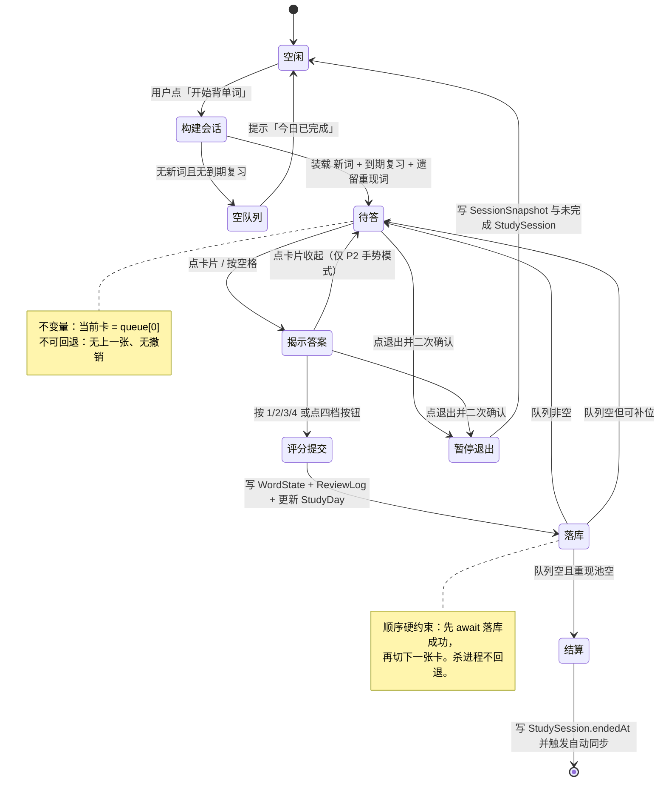
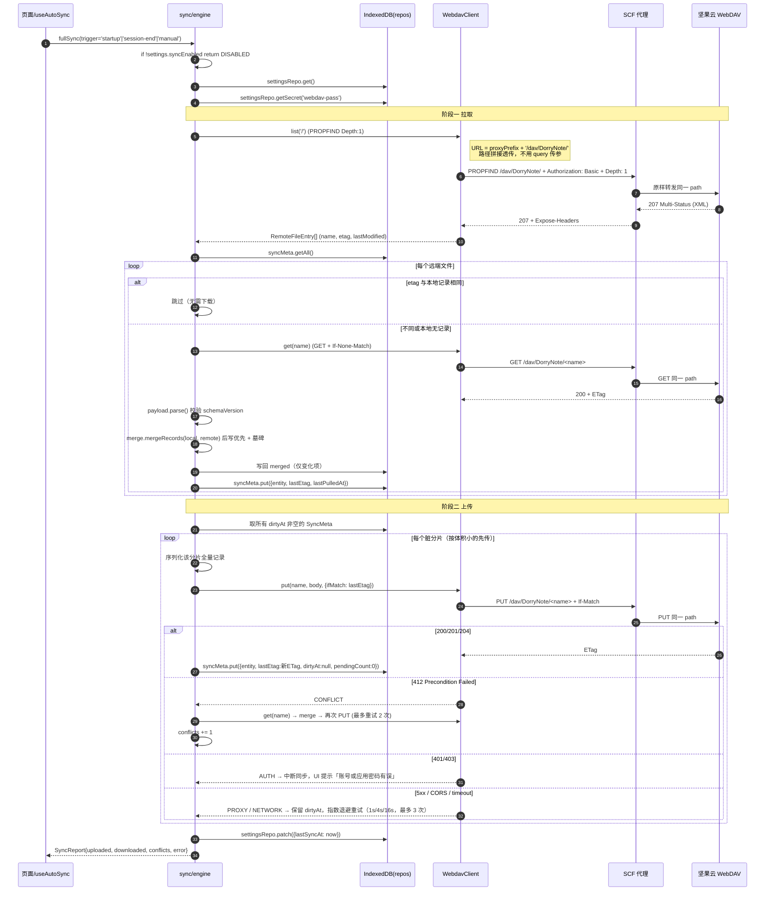
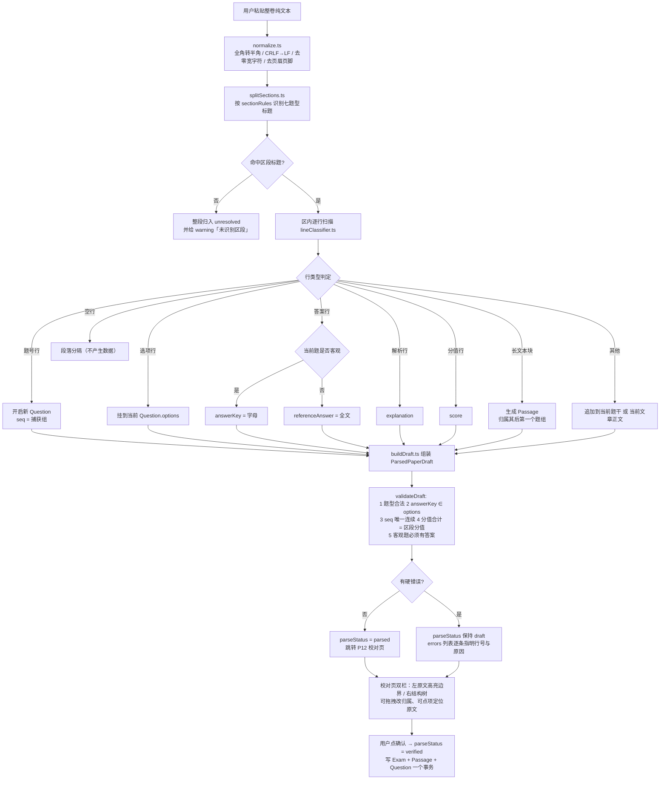
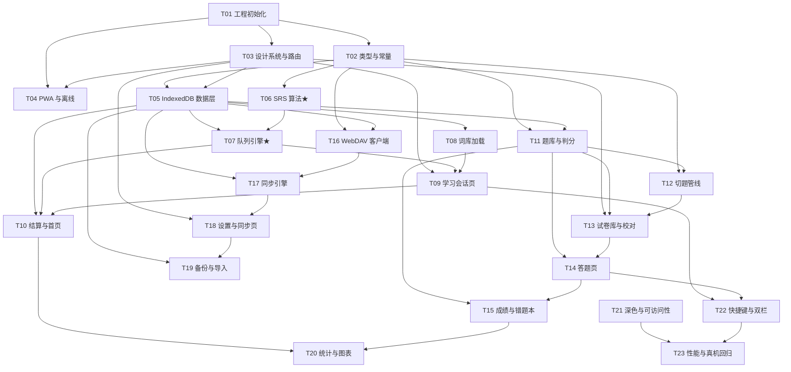

# 同等学力英语备考 PWA · 系统架构设计与任务分解

| 项目 | 内容 |
|---|---|
| 项目代号 | `tdxl_english_prep` |
| 文档版本 | v1.5 |
| 编写日期 | 2026-10-24 |
| 修订日期 | 2026-10-24（**v1.5**：★ **3.7.1 `MASTERED` 公式回滚**——v1.4 误加外层 `max(L,…)` 抹掉了 `max(L+2, 9)` 的「熟识保底进 60 天池」，L=0~6 共 7 档全错、44 组 fixture 挂 7 组，已改回 `min(max(L + 2, 9), 10)`；★ 词频数据落地，**R-01 关闭**，恢复 `core_top500.json`（215KB）、`Word.frequencyRank` 改为必填、删 `sourceOrder`、新增 `Word.letter`；★ 新增 3.2.4「学习顺序三选一」（`frequency` / `alphabetical` / `shuffled`）；★ 新增 3.2.5「释义必须全量渲染」硬约束；★ 全部体积数字改为实测值（2.13MB / gzip 396KB）；v1.4：取消 `core-top500`（当时无词频数据）+ 3.2.3 词频约束 W1~W3 + `Word.sourceOrder`；v1.3：3.7.1 `KNOWN` 只升不降、fixture 引用 `SRS-TEST-CASES.md`、`QUEUE_BUFFER=3`；v1.2：考试时长 9000s、`Word.meaning` 改 `Sense[]`；v1.1：代理改路径拼接、七题型改考纲第六版、考试日期改自动推算） |
| 架构师 | 高见远 |
| 上游文档 | `docs/PRD.md` **v1.4** |
| 目标读者 | 工程师（开发实施）、主理人 |
| 本文范围 | 技术选型、目录结构、类型契约、关键流程、任务分解、工程约定、iOS 坑位 |

> **阅读顺序建议**：工程师先看第 1、2、5 章建立全局，开工时逐条对照第 5 章任务；第 3 章类型定义是全项目的"合同"，第 7 章是写代码时的行为准则；第 8 章在做 iOS 联调前必须通读。

---

## 1. 技术选型与理由

### 1.1 选型总表

| 领域 | 选型 | 版本 | 为什么是它 | 放弃的方案及原因 |
|---|---|---|---|---|
| 构建工具 | **Vite** | `^7` | 冷启动 <1s、HMR 即时；原生动态 `import()` 便于词库分片 | webpack：配置冗长，对单人维护不友好 |
| 框架 | **React + TypeScript（strict）** | `^19` | 生态最大、问题可搜；TS 的 interface 能给 .NET 背景带来"强类型"的安全感 | Vue3：模板语法离 WPF 的 XAML 更远，且类型推导弱于 TSX |
| 语言模式 | TS `strict: true` + `noUncheckedIndexedAccess` | `^5.6` | 队列/数组下标操作多，必须防越界 | — |
| 样式方案 | **Tailwind CSS（PostCSS 模式）** | `^3.4` | 见 1.2 专节 | MUI、CSS-in-JS、纯 CSS Module |
| UI 基础件 | **自建 8 个原子组件** + 原生 `<dialog>` | — | 全项目只需 Button/Card/Sheet/Dialog/Toast/ProgressBar/SegmentedControl/NumberStepper | Radix UI：多一层抽象 + 学习成本 |
| 图标 | **内联 SVG 组件**（手写 path） | — | 只用到约 14 个图标，零依赖、零请求 | lucide-react：多 30KB，可用性收益低 |
| 路由 | **react-router（v7，声明式 `<Routes>`）** | `^7` | 声明式路由对新手最直观；不需要 loader/action 这类服务端概念 | TanStack Router：类型安全更强但配置面大 |
| 状态管理 | **Zustand** | `^5` | ~1KB；`create()` 后直接 `useStore()`，无 Provider/Reducer 样板 | Redux Toolkit：样板代码过多；Context：会话里高频更新会全树重渲染 |
| 本地数据库 | **Dexie.js** | `^4` | IndexedDB 封装里最成熟；`where('dueAt').belowOrEqual(now)` 正是"取到期复习词"要的能力；自带 schema 版本迁移 | 原生 idb：需要手写大量事务样板；localStorage：同步 API、5MB 上限，不可用 |
| 数据订阅 | **dexie-react-hooks `useLiveQuery`** | `^1.1` | 一行代码让页面随 IndexedDB 变化自动刷新，省掉手写订阅 | 手写事件总线：多一层维护 |
| PWA | **vite-plugin-pwa（Workbox）** | `^1` | 自动生成 manifest 与 SW、预缓存清单、`registerType: 'prompt'` 支持版本更新受控 | 手写 SW：缓存失效策略容易出错 |
| 日期 | **dayjs** | `^1.11` | 2KB，只用来做格式化与 `YYYY-MM-DD` 解析；调度计算全用毫秒数手算 | date-fns：tree-shaking 后仍更重；moment：体积大且已停止演进 |
| 图表 | **不引库，手写 2 个 SVG 组件** | — | 全项目只有「7 天到期柱状图」和「成绩趋势折线图」两种图 | Recharts（~110KB）/ECharts（~300KB）：为两张小图付这个体积不值 |
| 单元测试 | **Vitest + fake-indexeddb** | `^3` | 与 Vite 同源、零配置；算法纯函数与仓库层都能测 | Jest：需额外 babel/ts 转译链 |
| 网络请求 | **原生 `fetch`** | — | 只有 WebDAV 一类请求，`fetch` 足够且可控 `If-Match` 等头 | axios：多一个依赖，且对 `fetch` 无实质增益 |
| 代码规范 | **ESLint 9 flat config + Prettier** | — | 仅做基础约束，不引入类型感知规则（太慢） | — |
| 后端 | **无** | — | 单用户、离线优先，IndexedDB 即数据库 | 任何服务端都会破坏"断网可用" |

### 1.2 【决策】Tailwind vs MUI —— 选 Tailwind，且**只用一种**

**结论：全项目只用 Tailwind CSS，不安装 MUI，不使用 `sx` prop，不混用 CSS-in-JS。**

理由（按权重排序）：

| # | 理由 | 说明 |
|---|---|---|
| 1 | **本项目的 UI 是高度定制的** | 背单词卡片是「一屏一词、不可回退、底部四等分按钮」的特殊布局；MUI 的 `Card`/`Button` 几乎每个属性都要覆盖，最后会变成"MUI 外壳 + 大量 sx 覆写"，代码量比纯 Tailwind 更大，可读性更差 |
| 2 | **只有 5 个通用件真正需要"组件库"** | Dialog / Sheet / Toast / Tabs / Stepper。原生 `<dialog>` 在 iOS Safari 15.4+ 已支持，配合 Tailwind 三五十行即可；其余全是业务组件，MUI 帮不上忙 |
| 3 | **体积直接影响硬指标** | MUI（含 emotion）压缩后约 90~140KB gzip；Tailwind 按需生成后 CSS 约 8~12KB。PRD 要求首屏可交互 < 2s、二次访问 < 800ms |
| 4 | **深色模式只需一套机制** | Tailwind 的 `dark:` + CSS 变量切换只需在 `<html>` 上加/去 `dark` 类。MUI 需再叠一层 `ThemeProvider` + `palette.mode`，两套主题系统并存是复杂度灾难 |
| 5 | **对 .NET/WPF 背景的迁移成本更低** | Tailwind 的 `class` 是"就地声明的属性"，读 JSX 时视觉样式写在同一行，心智模型接近 XAML 的 `Background="..."`；MUI 的 `sx` 是 JS 对象 + 主题函数插值，调试时要跳两层 |
| 6 | **三端响应式靠断点前缀直接表达** | `md:grid-cols-[55%_45%]` 这类写法一眼能看出"1024px 以上变双栏"，正好对应 PRD 6.2.1 的四档断点表 |

**MUI 的唯一优势（现成可访问组件）用两条措施补偿**：
1. 原生 `<dialog>` + `showModal()` 自带焦点陷阱与 Esc 关闭；
2. 第 1 章选型里的 8 个原子组件统一处理 `aria-*`、44×44 触控尺寸、`:focus-visible` 描边。

**版本细节（重要，勿擅自升级）**：Tailwind 固定 `^3.4`，**不要用 v4**。Tailwind v4 依赖 `@property` / `color-mix()`，要求 Safari ≥ 16.4，而 PRD 第 10 章明确要求支持 iOS 16.0+ Safari。v3.4 + PostCSS 是唯一稳妥选择。

### 1.3 架构分层

```
┌──────────────────────────────────────────────────┐
│ pages/          页面（只做编排，不含算法）           │
├──────────────────────────────────────────────────┤
│ components/     展示组件（纯 props，不碰 DB/网络）   │
├──────────────────────────────────────────────────┤
│ store/          Zustand 内存态（会话、UI、同步状态） │
├──────────────────────────────────────────────────┤
│ lib/            纯函数（算法、切题、判分、合并）★可单测│
├──────────────────────────────────────────────────┤
│ db/repos/       仓库层（唯一允许访问 Dexie 的地方）   │
├──────────────────────────────────────────────────┤
│ db/index.ts     Dexie schema（表、索引、迁移）       │
└──────────────────────────────────────────────────┘
     侧向：lib/sync/ 可依赖 db + lib，但不可依赖 pages
```

**硬性约束**：
- `lib/srs/*`、`lib/exam/parse/*`、`lib/exam/grade.ts`、`lib/sync/merge.ts`、`lib/session/queue.ts` **必须是纯函数**（无 DB、无 `Date.now()`、无 `Math.random()` 直接调用，时间与随机数都从参数传入），否则单测写不动。
- 组件里 `import { db }` 视为违规，必须走 `repos`。
- 任何页面不得出现 `new Date()` 直接参与调度计算，一律走 `lib/time.ts` 的封装。

---

## 2. 目录结构与文件清单

> 每个文件后附一句话职责。**照此建文件即可开工**，新增文件需在本表登记。

```
tdxl_english_prep/
├── index.html                          # 唯一 HTML 入口，含 viewport-fit=cover、apple-mobile-web-app-* meta、启动图 link
├── package.json                        # 依赖与脚本（dev/build/preview/test/lint）
├── tsconfig.json                       # TS 主配置（strict、路径别名 @/*）
├── tsconfig.node.json                  # vite.config 等 node 侧脚本的 TS 配置
├── vite.config.ts                      # Vite + React + PWA 插件 + 路径别名 + 测试配置
├── tailwind.config.ts                  # 断点、颜色映射到 CSS 变量、darkMode:'class'
├── postcss.config.js                   # tailwindcss + autoprefixer
├── eslint.config.js                    # ESLint 9 flat config
├── .prettierrc                         # 格式化规则
├── .gitignore
│
├── scripts/
│   └── build-wordbook.mjs              # 离线词库切分脚本：源词库 → core-index.json + 26 字母分片 + core_top500.json
│
├── data-raw/
│   ├── wordbook_full.json              # 【已到手】5802 词 / 2.13MB raw（gzip 396KB），含 frequencyRank + letter，字段见 3.2.2；只作脚本输入，不打包
│   └── core_top500.json                # 【已到手】词频前 500 词（215KB / gzip 44KB），由 team-lead 产出；脚本拷到 public 即可
│
├── public/
│   ├── favicon.svg                     # 站点图标
│   ├── icons/
│   │   ├── icon-192.png                # manifest 图标 192
│   │   ├── icon-512.png                # manifest 图标 512
│   │   ├── icon-maskable-512.png       # Android/Win 蒙版图标（含 20% 安全边距）
│   │   └── apple-touch-icon-180.png    # iOS 主屏图标（不可用 webp/svg）
│   ├── splash/                         # iOS 启动图，按机型生成，文件名见 8.5
│   │   └── apple-splash-1170x2532.png  # ……共 8 张
│   └── data/
│       ├── words/
│       │   ├── core-index.json         # 词库清单 + 轻量索引：[{id,headword,norm,sourceOrder,frequencyRank,letter,shard}] + shards 清单 + totalCount=5802；首屏只加载它（~280KB / gzip 62KB）
│       │   │                            # 注：frequencyRank 当前恒为 null（无词频数据，见 3.2.3）；排序回退 sourceOrder
│       │   ├── core-a.json             # 字母 a 开头词条全文（含 meaning[] 义项数组），按需 fetch + 内存缓存
│       │   ├── core-b.json             # ……常规 26 片；某字母超 800 词时脚本可拆 core-s1/core-s2
│       │   └── core-z.json             # 具体文件名由 core-index.json 的 shards 字段声明，运行时不硬编码 26
│       └── exams/
│           ├── demo-a.json             # 示范卷 A（整卷 77 题：75 客观 + 2 主观 / 100 分 / 9000s）
│           └── demo-b.json             # 示范卷 B（同结构，内容不重复）
│
└── src/
    ├── main.tsx                        # 挂载 React、注册 SW、初始化设置与 DB、全局错误边界
    ├── App.tsx                         # 路由出口 + AppShell + Toast 容器 + 全局快捷键
    ├── router.tsx                       # 全部路由表（含懒加载与 404）
    ├── vite-env.d.ts                   # Vite 类型声明
    │
    ├── types/
    │   ├── index.ts                    # 统一 re-export，页面只从这里 import 类型
    │   ├── common.ts                   # Rating、Syncable、EntityId、StudyDay 等基础类型
    │   ├── word.ts                     # WordBook / Word / WordState / ReviewLog / NotebookEntry
    │   ├── session.ts                  # CardItem / StudySession / SessionSnapshot / QueueState
    │   ├── exam.ts                      # Exam / Section / Passage / Question / Attempt / AttemptAnswer / WrongItem
    │   ├── stats.ts                    # StudyDay、DailyStats、PlanEstimate
    │   └── sync.ts                     # Settings / SyncMeta / RemoteFileEntry / SyncReport / SyncErrorCode
    │
    ├── constants/
    │   ├── index.ts                    # 统一 re-export
    │   ├── srs.ts                      # L_MAX、INTERVAL_LADDER、MASTER_L、MAX_RETRY、RETRY_GAP、RESERVE_DAYS、UTILIZE、REVIEW_LOAD_CAP
    │   ├── routes.ts                   # 路由常量（避免字符串散落）
    │   ├── books.ts                    # 内置词库 ID、名称、分片清单
    │   ├── exam.ts                     # 七题型的枚举、中文名、配色、图标 key、是否客观题
    │   ├── storage.ts                  # Dexie 表名、remote 文件名模板、schemaVersion
    │   └── messages.ts                 # 所有中文提示文案常量（便于统一措辞）
    │
    ├── db/
    │   ├── index.ts                    # Dexie 实例（export const db = new TdxlDB()），全项目唯一
    │   ├── schema.ts                   # 表结构与索引定义 + schemaVersion 迁移函数
    │   ├── seed.ts                     # 首次启动写入内置词库索引/示范卷元信息/默认设置
    │   └── repos/
    │       ├── wordRepo.ts             # 词条查询、按字母分片懒加载、拼写搜索、内置词库索引缓存
    │       ├── bookRepo.ts             # 词库 CRUD、启用/停用、叠加去重计数
    │       ├── stateRepo.ts            # WordState 读写、按 dueAt 取到期词、批量 upsert、脏标记
    │       ├── sessionRepo.ts          # StudySession 快照读写、最近会话恢复
    │       ├── logRepo.ts              # ReviewLog 追加、按 date/wordId 查询、保留期裁剪
    │       ├── dayRepo.ts              # StudyDay 日汇总增量更新与查询
    │       ├── notebookRepo.ts         # 生词本增删改查、按来源筛选
    │       ├── examRepo.ts             # Exam/Passage/Question 的读写与整卷事务写入
    │       ├── attemptRepo.ts          # Attempt/AttemptAnswer 读写、按试卷取历史
    │       ├── wrongRepo.ts            # 错题本 upsert/标记已掌握/筛选
    │       └── settingsRepo.ts         # 单条设置读写、secrets（WebDAV 密码）独立表读写
    │
    ├── lib/
    │   ├── id.ts                        # newId(prefix)：时间有序 + 随机后缀
    │   ├── time.ts                      # now()、fmtDate()、fmtDuration()、msToNext0400()
    │   ├── num.ts                       # clamp、randInt（可注入随机源）、比例计算
    │   ├── errors.ts                    # AppError 类、错误码枚举、toUserMessage()
    │   ├── tts.ts                       # speak(word)、isTtsAvailable()、语音列表选择（美/英）
    │   ├── csv.ts                       # 轻量 CSV 行解析（支持双引号转义）
    │   ├── wordbookCache.ts             # 内置词库索引与字母分片的内存缓存 + normalizeWord()（stateKey 的唯一来源）
    │   │
    │   ├── srs/
    │   │   ├── studyDay.ts              # studyDayOf(ts, hour)、studyDayStart(day, hour)、nextStudyDay0400()
    │   │   ├── transition.ts             # ★核心：transition(state, rating, now, cfg) 纯函数
    │   │   ├── plan.ts                  # ★核心：dailyNewWordPlan()、estimateFinishDate()
    │   │   └── stats.ts                 # 今日已学/待复习/正确率/连续打卡/记忆曲线的纯计算
    │   │
    │   ├── session/
    │   │   ├── queue.ts                 # ★核心：enqueueRetry()、dequeueHead()、ensureMinSize()、pickNext()
    │   │   ├── buildSession.ts          # 会话预置：新词 + 到期复习 + 跨会话遗留 retryPool
    │   │   └── sessionMachine.ts        # 会话状态机：init/answer/pause/finish/restore，全部为 reducer 纯函数
    │   │
    │   ├── exam/
    │   │   ├── grade.ts                 # 客观题判分、总分汇总、错题生成（纯函数）
    │   │   ├── parse/
    │   │   │   ├── normalize.ts         # 文本归一化（全角转半角、CRLF、去零宽字符）
    │   │   │   ├── sectionRules.ts       # 七题型标题关键词与正则规则表
    │   │   │   ├── lineClassifier.ts     # 行级识别：题号/选项/答案/解析/分值/空行/长文本
    │   │   │   ├── splitSections.ts      # 区段切分 + 区内文章/题目切分
    │   │   │   └── buildDraft.ts         # 组装 ParsedPaperDraft + validateDraft + unresolved 清单
    │   │   └── drill.ts                 # 专项练习抽题（按题型/题量，纯函数）
    │   │
    │   ├── sync/
    │   │   ├── webdav.ts                # ★WebDAV 客户端：list/get/put/remove/mkcol，含 If-Match 与错误映射
    │   │   ├── shards.ts                 # 分片规则：wordstate 按 hash(wordId)%8、reviewlog 按月分片
    │   │   ├── merge.ts                  # ★冲突合并纯函数：mergeRecords()、pickWinner()
    │   │   ├── payload.ts               # 实体 ↔ 远端文件内容的序列化/反序列化与校验
    │   │   └── engine.ts                # 同步引擎：pull/push/fullSync、待上传队列、退避重试
    │   │
    │   ├── backup/
    │   │   ├── export.ts                # 全量导出为 JSON（脱敏 secrets）与文件名生成
    │   │   └── import.ts                # 备份导入（合并/覆盖）、结果摘要计算
    │   │
    │   └── importers/
    │       ├── vocabText.ts             # TXT/CSV 词库解析 → {words, errors, dupCount}
    │       └── examJson.ts              # 试卷 JSON 校验与导入
    │
    ├── store/
    │   ├── settingsStore.ts             # 设置内存镜像 + 写库 + 触发同步防抖
    │   ├── sessionStore.ts              # 学习会话内存态（队列、当前卡、是否显示答案）
    │   ├── attemptStore.ts              # 答题会话内存态（当前题、标记、倒计时、草稿）
    │   ├── syncStore.ts                 # 同步状态（进行中/上次同步/待上传数/失败原因）
    │   └── uiStore.ts                   # 主题、Toast 队列、Sheet/Dialog 开关、离线提示
    │
    ├── hooks/
    │   ├── useMediaQuery.ts             # 断点判断（isPhone/isTablet/isDesktop）
    │   ├── useOnlineStatus.ts           # 在线/离线（含 navigator.onLine + 心跳）
    │   ├── usePwaUpdate.ts              # SW 更新检测与 deferring 逻辑（会话中不打断）
    │   ├── useSpeak.ts                  # TTS 封装，含用户手势要求与不可用降级
    │   ├── useHotkeys.ts                # 全局快捷键注册，输入框聚焦时自动屏蔽
    │   └── useAutoSync.ts               # 启动拉取、可见性恢复、退出前补传
    │
    ├── components/
    │   ├── layout/
    │   │   ├── AppShell.tsx             # 四端布局骨架：侧边栏/导轨/底部标签栏切换
    │   │   ├── Sidebar.tsx              # ≥1280px 左侧 220px 固定导航
    │   │   ├── Rail.tsx                 # 1024~1279px 左侧 72px 图标导轨
    │   │   ├── TabBar.tsx               # <1024px 底部 56px 标签栏（含安全区内边距）
    │   │   ├── TopBar.tsx               # 页面标题 + 倒计时 + 右侧操作
    │   │   └── OfflineBanner.tsx        # 离线模式提示条
    │   ├── ui/
    │   │   ├── Button.tsx               # 主/次/危险/幽灵四变体，≥44px 触控
    │   │   ├── Card.tsx                 # 圆角 12px 容器，支持 title/action 插槽
    │   │   ├── Sheet.tsx                # 移动端底部抽屉（答题卡、退出确认、选项面板）
    │   │   ├── Dialog.tsx               # 基于原生 <dialog> 的确认框
    │   │   ├── Toast.tsx                # 轻提示（成功/失败/信息），自动消失
    │   │   ├── ProgressBar.tsx          # 进度条（会话进度、导入进度、SW 缓存进度）
    │   │   ├── SegmentedControl.tsx     # 分段控件（自动/浅色/深色、题型筛选）
    │   │   ├── NumberStepper.tsx        # 数字步进器（每日新词 1~200）
    │   │   ├── EmptyState.tsx           # 空状态占位（含引导按钮）
    │   │   ├── Tag.tsx                  # 题型/词性/状态小标签
    │   │   ├── ListRow.tsx              # 通用列表行（左主文案 + 右副文案 + 箭头）
    │   │   └── UpdatePrompt.tsx         # SW 新版本更新提示条（会话中自动延后）
    │   ├── charts/
    │   │   ├── BarChart.tsx             # 未来 7 天到期量迷你柱图（纯 SVG）
    │   │   └── LineChart.tsx            # 真题成绩趋势折线（纯 SVG）
    │   ├── word/
    │   │   ├── WordCard.tsx             # 单词卡片（正面/答案态两态，单栏用）
    │   │   ├── WordDetailPanel.tsx      # 词条详情面板（iPad/Windows 右栏，含收藏与历史）
    │   │   ├── RatingBar.tsx            # 四档按钮组（含 1~4 数字角标）
    │   │   └── WordListItem.tsx         # 词条列表项（生词本、搜索结果）
    │   ├── exam/
    │   │   ├── QuestionView.tsx         # 单题渲染（题干/选项/blankIndex）
    │   │   ├── PassageView.tsx          # 文章渲染（可折叠、可对照译文）
    │   │   ├── AnswerSheet.tsx          # 答题卡网格（未答/已答/已标记三态）
    │   │   ├── Countdown.tsx            # 倒计时（可暂停，剩 5 分钟变红）
    │   │   └── ParseTree.tsx            # 切题结果树（区段 → 文章 → 题目）
    │   └── feedback/
    │       ├── ErrorBoundary.tsx        # 顶层错误边界，捕获后给"重载/导出备份"出口
    │       └── LoadingView.tsx           # 全屏加载与骨架屏
    │
    ├── pages/
    │   ├── HomePage.tsx                 # P01 今日首页（倒计时、任务清单、数据卡、词库卡）
    │   ├── study/
    │   │   ├── StudyPage.tsx            # P02 学习会话（单栏/双栏自适应）
    │   │   └── StudySummaryPage.tsx     # P03 会话结算
    │   ├── plan/
    │   │   └── PlanPage.tsx             # P04 学习计划（参数 + 推算结果）
    │   ├── words/
    │   │   ├── BooksPage.tsx            # P05 词库管理
    │   │   ├── BooksImportPage.tsx      # P06 词库导入向导
    │   │   ├── WordDetailPage.tsx       # P07 词条详情（独立页形态）
    │   │   ├── NotebookPage.tsx         # P08 生词本
    │   │   └── StatsVocabPage.tsx       # P09 单词统计
    │   ├── exams/
    │   │   ├── ExamsPage.tsx            # P10 试卷库
    │   │   ├── ExamEditPage.tsx         # P11 试卷录入（三 Tab）
    │   │   ├── ParseReviewPage.tsx      # P12 切题校对（双栏）
    │   │   ├── ExamStartPage.tsx        # P13 组卷/开始模拟
    │   │   ├── AttemptPage.tsx          # P14 客观题答题
    │   │   ├── AttemptSubjectivePage.tsx# P15 主观题作答与自评
    │   │   ├── AnswerSheetPage.tsx      # P16 答题卡抽屉页
    │   │   ├── ResultPage.tsx           # P17 成绩单
    │   │   ├── ReviewPage.tsx           # P18 解析回看
    │   │   ├── DrillPage.tsx            # P19 专项练习配置
    │   │   ├── WrongBookPage.tsx        # P20 错题本
    │   │   └── StatsExamsPage.tsx       # P21 真题成绩曲线
    │   ├── settings/
    │   │   ├── SettingsPage.tsx         # P22 设置（分组表单）
    │   │   ├── SettingsSyncPage.tsx     # P23 同步与备份
    │   │   └── SettingsBackupPage.tsx   # P24 导出/导入
    │   └── SearchPage.tsx               # P25 全局搜索（P2）
    │
    ├── styles/
    │   ├── tokens.css                   # ★全部 CSS 变量（颜色/字号/间距/圆角/阴影/安全区）
    │   └── app.css                       # Tailwind 指令 + base 重置 + 少量全局类（safe-area、no-scrollbar）
    │
    └── test/
        ├── setup.ts                     # Vitest 环境（fake-indexeddb、crypto.randomUUID 垫片）
        ├── fixtures/
        │   ├── studyCases.ts            # PRD 5.7 用例 A/B/C 的数据
        │   ├── stateTable.ts            # ★44 组转移矩阵 + 6 组边界，从 docs/SRS-TEST-CASES.md 第 6 节 JSON 原样粘入（PM 交付的事实源）
        │   ├── paperText.ts             # 切题用的整卷纯文本样例（77 题：75 客观 + 2 主观）
        │   └── stateTable.ts            # 11 级 × 4 评分的期望结果表
        └── *.test.ts                    # 与被测文件同名，就近原则放 src 内也可
```

**文件数统计**：约 130 个文件，其中约 60 个是薄壳（页面/原子组件）。真正的技术难点集中在 `lib/srs`、`lib/session`、`lib/exam/parse`、`lib/sync` 四个目录，共 18 个文件。

---

## 3. 核心类型定义

> 全部放在 `src/types/`，`src/types/index.ts` 统一 re-export。**字段命名以本节为准，与 PRD 第 7 章的对应关系用括号注明**。

### 3.1 基础类型 `types/common.ts`

```ts
/** 四档反馈：1 不认识 / 2 模糊 / 3 认识 / 4 熟识 */
export type Rating = 1 | 2 | 3 | 4;

export const RATING = {
  FORGOT: 1,
  VAGUE: 2,
  KNOWN: 3,
  MASTERED: 4,
} as const satisfies Record<string, Rating>;

/** 熟练度等级 0~10 */
export type Level = number;

/** 所有时间戳一律为 UTC 毫秒数（number），显示时才转本地 */
export type Timestamp = number;

/** 学习日，本地时区下的 YYYY-MM-DD（按 DAY_START_HOUR 折算后的日期） */
export type StudyDayKey = string;

export type EntityId = string;

/** 所有可同步实体的公共字段 */
export interface Syncable {
  updatedAt: Timestamp;
  /** 墓碑：null 表示未删除；非 null 表示已删除的时间 */
  deletedAt: Timestamp | null;
}

/** 全项目统一的结果包装（仓库层返回，不抛异常的场景） */
export type Result<T> = { ok: true; value: T } | { ok: false; error: AppErrorShape };

export interface AppErrorShape {
  code: string;
  message: string;
  detail?: unknown;
}
```

### 3.2 单词域 `types/word.ts`

```ts
import type { EntityId, Level, Rating, Syncable, Timestamp } from './common';

/** 词库（PRD 中称 VocabBook） */
export interface WordBook extends Syncable {
  id: EntityId;
  name: string;
  /** builtin 内置 / imported 用户导入 / virtual-notebook 生词本虚拟库 */
  source: 'builtin' | 'imported' | 'virtual-notebook';
  /** 词条数（冗余，便于列表展示，写入时维护） */
  wordCount: number;
  /** 是否参与学习 */
  enabled: boolean;
  /** 多词库叠加顺序，数字小者优先 */
  priority: number;
  createdAt: Timestamp;
}

/**
 * 义项（对应 `data-raw/wordbook_full.json` 的 `meaning[]` 元素，字段名保持一致以减少映射代码）
 * 例：{ pos: 'adj', text: '坚定的；牢固的；严格的；结实的' }
 */
export interface Sense {
  /** 词性，如 'n' / 'adj' / 'vt'；可为空串 */
  pos: string;
  /** 中文释义（可含分号分隔的多个近义解释，展示时按 PRD 6.3.2 一行一义项） */
  text: string;
}

/** 例句 */
export interface Example {
  en: string;
  zh?: string;
}

/** 词根词缀 */
export interface WordRoot {
  type: 'prefix' | 'root' | 'suffix';
  text: string;
  meaning: string;
}

/** 词条 */
export interface Word extends Syncable {
  /** 内置词库 id = `${bookId}:${norm}`；用户导入词 id 同规则，保证去重天然成立 */
  id: EntityId;
  bookId: EntityId;
  /** 单词/词组原文，展示用（对应源数据 word 字段） */
  headword: string;
  /** 归一化：小写 + 去首尾空格 + 多空格合一；去重、搜索、stateKey 都基于它 */
  norm: string;
  /** 对应源数据 phoneticUS；实测覆盖率 100% */
  phoneticUS?: string;
  /** 对应源数据 phoneticUK */
  phoneticUK?: string;
  /** 词性列表，如 ['adj','vt']；由 meaning[].pos 去重聚合，实测覆盖 99.9% */
  pos?: string[];
  /**
   * 结构化义项（**不是字符串**）。一行一个义项，前面带词性，
   * 满足 PRD 6.3.2「多义项分行」要求。
   */
  meaning: Sense[];
  /** 源数据原样释义字符串，仅作兜底与列表预览（避免拆分渲染时拼接出错） */
  meaningRaw?: string;
  /** 例句：实测当前数据源无此字段，为空时卡片整块隐藏，不得编造 */
  examples?: Example[];
  /** 助记：同上，为空则整块隐藏 */
  mnemonic?: string;
  roots?: WordRoot[];
  /**
   * 词频序（**越小越高频**）。实测覆盖率 **100%（5802/5802，全部唯一）**：
   * 5703 词命中 OpenSubtitles 50k 词频表（1~65744），99 个未命中者由脚本排 `60000 + 序号` 垫底。
   * 因此它是**必填的 `number`，不存在 `undefined`**，可作为新词排序的唯一主键（见 3.2.4）。
   * 严禁任何代码拿"字母序 / 源文件下标"冒充它（PRD WRD-17）。
   */
  frequencyRank: number;
  /** 首字母 `a`~`z`，由 norm 派生；供分片与「字母序」学习顺序使用，实测覆盖 100% */
  letter: string;
  /** 预留：本地/远程音频地址，P0 不启用，一律走系统 TTS */
  audioUrl?: string;
  createdAt: Timestamp;
}
```

#### 3.2.2 内置词库源数据契约（**v1.5 已按实测数据重核对**，按此实现）

数据来源：`data-raw/wordbook_full.json`（考纲配套词表 + 外部词频注入，已由 team-lead 产出）。**这是唯一数据源，不要再等"种子 500 词"。**

| 项 | 实测值（`node` 实跑统计，非估算） |
|---|---|
| 唯一词条数 | **5802**（原始 5816 行，去重 5 个） |
| 文件体积 | **2.13 MB** raw（2,236,223 bytes）／ **gzip 396 KB**（level 9 实测） |
| `phoneticUK` / `phoneticUS` 覆盖率 | **100%**（0 条缺失） |
| `pos` 覆盖率 | **99.9%**（5797 条有，5 条无） |
| `meaning` 覆盖率 | **100%**；结构 `{"pos":"n","text":"公司；商号"}` → 直接映射 `Sense[]` |
| 义项数分布 | 最多 **7 条**、均值 **1.94**；单义项 **2484** 词、≥5 义项 **52** 词（**排版必须按 7 条上限做压力测试**） |
| `frequencyRank` | **100% 有值且唯一**；命中 5703（min 1 / max 65744），未命中 99 个排 `60000+序号` |
| `letter` | **100%**，`a`~`z`；最大片 `s` = **689 词 / 236KB raw**（< 800，故 26 片不再拆） |
| 例句 / 助记 | **源数据没有**。字段留空 → 卡片对应区块整块隐藏，**严禁编造** |

**字段映射表（T08 的切分脚本照此写，字段名保持一致，不做二次改名）**

| 源数据字段 | `Word` 字段 | 处理 |
|---|---|---|
| `word` | `headword` | 原样（**注意源字段叫 `word`，不叫 `headword`**） |
| `norm` | `norm` | 原样（脚本已归一化；若不合法则由 `normalizeWord()` 兜底） |
| `phoneticUK` | `phoneticUK` | 原样 |
| `phoneticUS` | `phoneticUS` | 原样 |
| `pos` | `pos` | 按 `/` 切分为 `string[]` |
| `meaning[]` | `meaning` | **直接赋值**，元素结构完全一致（`pos` + `text`），**不重排、不裁剪** |
| `meaningRaw` | `meaningRaw` | 原样 |
| `frequencyRank` | `frequencyRank` | **原样透传，必填**；脚本校验「无 `undefined`、无重复」 |
| `letter` | `letter` | 原样透传（不得由 `norm[0]` 现推，避免大小写/特殊字符边界） |
| — | `examples` / `mnemonic` / `roots` | 全部 `undefined` |
| 脚本生成 | `id` = `core:${norm}`、`bookId` = `'core'` | — |
| 脚本生成 | `createdAt` | 固定常量（如 `1760000000000`），**不得用 `Date.now()`**，否则每次构建产物 diff 都会变 |

> `sourceOrder` 已在 v1.5 **删除**：它原本是"没有词频数据时的排序回退键"。词频已 100% 覆盖且唯一，保留它只会诱导误用（PRD WRD-17 明令禁止拿下标冒充词频）。

#### 3.2.3 词频口径（PRD WRD-17，**P1 验收项**）

| # | 约束 |
|---|---|
| F1 | `frequencyRank` **必填、唯一、无 `undefined`**。脚本产出后必须自检：`new Set(ranks).size === 5802`。 |
| F2 | **禁止用字母序 / 源文件下标冒充词频序**。`abacus` 必须排在 `ability` 之后而不是靠"它是 a 的第 2 个词"。 |
| F3 | 未命中词频表的 99 个词由脚本排 `60000 + 序号` 垫底，**不得因此报错、漏词或从词库消失**（WRD-17 ⑤）。 |
| F4 | 一个产品事实要写进 UI 文案：**语料词频 ≠ 考试价值**。高频前 30 位是 `you / I / the / to / a / it / and / that / of / in / what / we…` 这类功能词与基础实词，对备考者偏简单——这正是「学习顺序三选一」存在的理由（3.2.4）。设置页必须给人话提示：「高频区可能偏基础，觉得太简单可换乱序」。 |

#### 3.2.4 【v1.5 新增】学习顺序三选一（对应 PRD 4.2.1 / WRD-17）

`Settings` 新增两个字段：

```ts
/** 新词取词顺序。默认 'frequency'。切换不清空任何进度（PRD 4.2.1 O1） */
learningOrder: 'frequency' | 'alphabetical' | 'shuffled';
/** 乱序种子：首次进入乱序时生成一次并**永久固定**，切换顺序不清除。不得每次调用重算 */
shuffleSeed: number;
```

| 顺序 | 取值 | 排序键 | 实现要点 |
|---|---|---|---|
| 高频优先（默认） | `frequency` | `frequencyRank` 升序 | 直接比对数值；**并列时以 `norm` 兜底**保证稳定排序 |
| 字母序 | `alphabetical` | `norm` 升序 | **天然最优路径**：同一会话 35 个新词基本落在 1 个字母分片，分片命中率最高 |
| 乱序 | `shuffled` | `hash(shuffleSeed + ':' + norm)` 升序 | 用确定性哈希做键，**不用 Fisher-Yates 全量洗牌**——全量洗牌每次都要把 5802 条排一遍且结果依赖数组顺序；哈希键可以只对候选集排序，且**任意子集的前 N 个恒定**（O3 要求「第 N 个新词始终是同一个词」） |

**三条铁律（PRD 4.2.1 O1~O3，架构侧如何天然满足）**

| # | 要求 | 架构保障 |
|---|---|---|
| O1 | 切换顺序**不重置进度** | 进度挂在 `WordState.stateKey`（3.2.1），与顺序完全解耦；`transition()` 签名里根本没有顺序参数 → **物理上不可能受其影响** |
| O2 | 顺序**只影响取哪些新词**，复习队列恒按 `dueAt` 升序 | `buildSession()` 分两段取数：复习段只按 `dueAt`；顺序只作用于新词段 |
| O3 | 乱序**种子持久化可复现** | 种子存 `Settings.shuffleSeed`，参与同步；`shuffleKey(norm, seed)` 是纯函数，单测可断言「同一 seed 取两次前 35 个完全相同」 |

**唯一允许读 `learningOrder` 的两个位置**：`buildSession()` 取新词、`refillQueue` 的调用方构造 refill。**`transition()` / `ensureMinSize()` / 复习查询一律禁止感知它**——多一处读取就多一处"背着背着顺序变了"的隐患。

#### 3.2.5 【v1.5 新增 · 产品级硬约束】释义必须全量渲染（PRD 6.3.2 / 风险 R-03）

**源词表的义项顺序不规范，生僻义可能排在最前**（实测确认）：

| 词 | 第 1 义（**生僻**） | 第 2/3 义（常用） |
|---|---|---|
| `send` | `n. 上升运动` | `vi. 派人；寄信` / `vt. 发送，寄；派遣…` |
| `frank` | `n. 免费邮寄特权` | `adj. 坦白的，直率的；老实的` / `vt. 免费邮寄` |

因此：

| # | 硬约束 |
|---|---|
| M1 | `meaning` 数组**全部渲染，一条不省**。不准 `slice(0, n)`、不准"展开更多"、不准折叠、不准按词性筛选。 |
| M2 | **不重排**。即便能猜到 `adj.` 更常用，也不许按词性/长度重排——无数据可判断常用度，硬排会引入新错误。 |
| M3 | 每条义项**独立一行**，行首带 `pos`（`adj. ` / `vt. ` 形式），行高 1.6。 |
| M4 | 义项过多时**内容区纵向滚动**，不截断语义内容。卡片答案态**高度不固定**（见 T09 排版结论）。 |
| M5 | 单测断言：任取 `frank`，渲染结果的文本必须同时包含"免费邮寄特权"和"坦白的"，且"免费邮寄特权"**在前**（顺序一致）。 |

> 只显示第一条会造成**实质错误**（用户会以为 *frank* 是「免费邮寄特权」），这比不显示更糟。M1~M4 是 P0 验收项，T09 排版方案里任何"义项超过 N 条则截断"的设计都必须删掉。

**UI 影响（T09 必须遵守）**
- 释义区渲染 `meaning.map(s => \`${s.pos}. ${s.text}\`)`，**一行一个义项**，不合并成一段。
- `examples` / `mnemonic` 为空时**不渲染标题、不渲染空行、不留占位**，卡片自然收缩（PRD 6.3.2）。
- 卡片不存在"例句区"占位——这会显著改变视觉重心，实际内容只有「单词 + 音标 + 词性 + 1~7 条义项」。排版建议：单词下 24px 放音标，再 16px 放义项列表，义项行高 1.6。

```ts
/** 单词学习状态（核心，每词一条） */
export interface WordState extends Syncable {
  /**
   * 主键 = 学习身份键，见 3.2.1 裁决。
   * 取值为 `fnv1a(norm)` 的十进制字符串，跨词库共享同一份学习状态。
   */
  stateKey: string;
  /** 最近一次来源词条 ID，仅用于展示与回溯，不参与唯一性判断 */
  wordId: EntityId;
  /** 冗余，便于按库统计与分片 */
  bookId: EntityId;
  /** 熟练度等级 0~10 */
  level: Level;
  /** 下次到期时间戳，调度的唯一依据 */
  dueAt: Timestamp;
  /** 最近一次评分 */
  lastRating: Rating | null;
  lastReviewAt: Timestamp | null;
  /** 首次学习时间，用于「今日新词」统计 */
  firstLearnedAt: Timestamp | null;
  reviewCount: number;
  correctCount: number;
  wrongCount: number;
  /** 「不认识」累计次数 */
  lapseCount: number;
  /** 今日会话内重现次数（学习日切换时归零） */
  retryCountToday: number;
  /**
   * 【架构补充】retryCountToday 归属的学习日。
   * 用于判断该计数是否已过期需清零——PRD 未定义此字段，缺它无法实现"跨日清零"。
   */
  retryDay: StudyDayKey;
  /** 今日达 MAX_RETRY 仍答错，次日首页提示「N 个词不稳定，建议重背」 */
  unstable: boolean;
  /** 是否收藏（生词本主开关，冗余便于快查） */
  isStarred: boolean;
  /** 首次达到 MASTER_L 的时间 */
  masteredAt: Timestamp | null;
}

/** 答题流水（追加型，按月分片同步） */
export interface ReviewLog {
  id: EntityId;
  /** 词条 ID（Word.id） */
  wordId: EntityId;
  /** 学习身份键（见 3.2.1），统计去重用这个 */
  stateKey: string;
  sessionId: EntityId;
  rating: Rating;
  prevLevel: Level;
  newLevel: Level;
  prevDueAt: Timestamp;
  newDueAt: Timestamp;
  answeredAt: Timestamp;
  /** 看卡耗时，用于识别「秒过」异常 */
  durationMs: number;
  /** 是否当日重现轮次 */
  isRetry: boolean;
  deviceId: string;
}

/** 生词本条目（PRD 中称 WordbookEntry） */
export interface NotebookEntry extends Syncable {
  id: EntityId;
  wordId: EntityId;
  /** 冗余，词条被删后仍可展示 */
  headword: string;
  source: 'manual' | 'exam-wrong' | 'imported';
  /** 来源试卷/题目 ID */
  sourceRef: string | null;
  note: string;
  createdAt: Timestamp;
}
```

#### 3.2.1 【架构裁决】学习身份键 `stateKey`

**问题**：PRD 7.2 规定 `Word.id = bookId + ':' + norm`，而 WRD-11 要求「在 A 词库学过的词出现在 B 词库时，沿用同一 `level` 与 `dueAt`」。若 `WordState` 主键直接用 `Word.id`，同一单词在两个词库里会有两份互不相干的学习状态，WRD-11 无法实现。

**裁决**：`WordState` 的主键不用 `Word.id`，改用 **`stateKey = fnv1a(norm)` 的十进制字符串**。

| 影响面 | 处理方式 |
|---|---|
| `WordState` | 主键 `stateKey`；`wordId` 降为普通字段（记录最近一次来源词条） |
| `CardItem` | 同时携带 `wordId`（去取词条内容）与 `stateKey`（去取学习状态） |
| `ReviewLog` | 同时带 `wordId` 与 `stateKey` |
| `transition()` 入参/出参 | 只认 `stateKey`，完全不感知 `wordId` |
| 同步分片 | 按 `hash(stateKey) % 8` 分片 |
| 统计 | 一切都按 `stateKey` 去重 |
| 生词本 | `NotebookEntry.wordId` 仍为 `Word.id`；查学习状态时现算 `stateKey` |

**收益**：WRD-11 天然成立，无需任何同步/对账逻辑；词库叠加、生词本虚拟库、导入重复词的进度合并全部自动正确。
**风险**：`norm` 归一化规则一旦变更（如大小写策略调整），`stateKey` 会漂移。**因此 `norm` 规则冻结在 `lib/wordbookCache.ts` 的 `normalizeWord()` 一处，任何改动必须同步写迁移脚本。**

### 3.3 学习会话域 `types/session.ts`

```ts
import type { EntityId, Rating, StudyDayKey, Timestamp } from './common';

/** 队列中的一张卡 */
export interface CardItem {
  /** React key：`${kind}:${stateKey}:${round}`，重入队列时 round 变化以触发重挂载 */
  key: string;
  /** 词条 ID，用于取单词内容（Word.id） */
  wordId: EntityId;
  /** 学习身份键，用于取/写 WordState（见 3.2.1） */
  stateKey: string;
  kind: 'new' | 'review' | 'retry';
  /** 该卡是第几轮（new=0；retry=1..MAX_RETRY） */
  round: number;
}

/** 重现池条目（会话内 + 跨会话遗留都存这个结构） */
export interface RetryPoolEntry {
  stateKey: string;
  wordId: EntityId;
  retryCount: number;
  /** 上次计算的目标位置，仅用于快照调试 */
  nextAppearPos: number;
  kind: 'new' | 'review' | 'retry';
}

/** 会话状态机状态（内存态，由 sessionMachine 纯函数驱动） */
export interface QueueState {
  /** 待答卡片数组。不变量：当前卡恒为 queue[0]；同一 wordId 至多出现一次 */
  queue: CardItem[];
  /** 重现池 */
  retryPool: Record<EntityId, RetryPoolEntry>;
  /** 已作答卡数（进度分子） */
  answeredCount: number;
  /** 本次会话的初始计划量（进度分母基数，队列补位时动态增加） */
  plannedTotal: number;
  /** 本次会话是否已结束 */
  status: 'active' | 'finished' | 'abandoned';
}

/** 一次学习会话（落库，可同步） */
export interface StudySession extends Syncable {
  id: EntityId;
  studyDay: StudyDayKey;
  startedAt: Timestamp;
  endedAt: Timestamp | null;
  /** 新词答卡数 / 复习答卡数 */
  newCount: number;
  reviewCount: number;
  /** 答题总次数（含重现轮） */
  answerCount: number;
  correctCount: number;
  /** 四档分布 */
  ratingCounts: Record<'1' | '2' | '3' | '4', number>;
  /** 用时秒数，按 30 分钟截断后计入 StudyDay */
  durationSec: number;
  /** 本次出现的、达上限仍答错的词 */
  unstableWordIds: EntityId[];
  deviceId: string;
}

/** 会话快照（用于异常退出后恢复重现池，PRD 5.4 R9） */
export interface SessionSnapshot {
  sessionId: EntityId;
  studyDay: StudyDayKey;
  startedAt: Timestamp;
  updatedAt: Timestamp;
  answeredCount: number;
  retryPool: Record<EntityId, RetryPoolEntry>;
  ratingCounts: Record<'1' | '2' | '3' | '4', number>;
  /** 已答过、需在下次会话优先重现的词（按 R9 插到队首 3 位内） */
  carryOverWordIds: EntityId[];
}

export interface SubmitAnswerInput {
  wordId: EntityId;
  rating: Rating;
  /** 看卡耗时，用于 ReviewLog */
  durationMs: number;
  /** 难度：本卡是否重现轮 */
  isRetry: boolean;
}
```

### 3.4 真题域 `types/exam.ts`

```ts
import type { EntityId, Syncable, Timestamp } from './common';

/** 七大题型 */
export type SectionType =
  | 'dialogue'          // 口语交际
  | 'vocabulary'        // 词汇
  | 'reading'           // 阅读理解
  | 'cloze'             // 完形填空
  | 'short-completion'  // 短文完成
  | 'translation'       // 英译汉
  | 'writing';          // 写作

/** 区段（试卷的组成单元，定义分值而不定义题目） */
export interface Section {
  type: SectionType;
  /** 区段顺序，1 起 */
  order: number;
  /** 区段总分，由试卷数据定义，不硬编码 */
  score: number;
  /** 该区段题目数（客观+主观都算）。标准卷合计 = 77 题位 */
  questionCount: number;
  /** 该区段下的文章 ID 列表（无文章的题型为空数组） */
  passageIds: EntityId[];
}
```

#### 3.4.1 七题型官方分值结构（《英语水平全国统一考试大纲》第六版）

> **这是唯一权威口径**，写在 `constants/exam.ts` 的 `SECTION_META` 里，用于：示范卷构造、区段分值校验（`Σ section.score === exam.totalScore`）、成绩单分项、专项练习抽题上限。**试卷数据仍然逐卷定义分值**（真实真题可能微调），上表是"默认模板 + 校验基准"。

| 序号 | 题型 | `SectionType` | 题量 | 记分 | 参考用时 | 客观题 |
|---|---|---|---|---|---|---|
| Ⅰ | 口语交际 | `dialogue` | 10 | 10 | 15 min | 是 |
| Ⅱ | 词汇 | `vocabulary` | 10 | 10 | 10 min | 是 |
| Ⅲ | 阅读理解 | `reading` | 25 | 25 | 45 min | 是 |
| Ⅳ | 完形填空 | `cloze` | 10 | 10 | 10 min | 是 |
| Ⅴ | 短文完成 | `short-completion` | 20 | 20 | 20 min | 是 |
| Ⅵ | 英译汉 | `translation` | 1（100 词左右） | 10 | 20 min | **否** |
| Ⅶ | 写作 | `writing` | 1（不少于 150 词） | 15 | 30 min | **否** |
| **合计** | | | **75 客观 + 2 主观** | **100** | **150 min** | |

**由此推导的硬约束（必须写进校验）**
- `exam.totalQuestions === 77`（= **75 道客观题 + 2 道主观题 = 77 个题位**）；`exam.totalScore === 100`。
- **答题卡网格按 77 个格子渲染**（不是 75）：主观题也要有格子，显示为「译」「写」两个特殊格，未作答时同为「未答」态。
- `Σ section.questionCount === 77`，各区段为 `10 / 10 / 25 / 10 / 20 / 1 / 1`。
- `exam.timeLimitSec === 9000`（**150 min**，与考纲及 PRD 一致）。
- 主观题 2 道（英译汉 10 分 + 写作 15 分 = 25 分）**不进客观分**，成绩单必须拆成「客观 75 / 主观 25 / 总分」三段展示。
- 客观题 75 道的 `score` 均为 1 分；若用户录入的真题分值不同，以试卷数据为准，不强制。
- **短文完成（`short-completion`）虽名为「补全短文」，本质是选词填空 → `isObjective = true`**，判分走选项字母比对，**不得做自由文本比对或模糊匹配**。
- **客观 75 / 主观 25 的配比不可配置**（`EXAM_TOTAL_SCORE` 可配置性为「否」）。除"用户录入真题自带分值"外，不得把它做成设置项。

```ts
/** 试卷（PRD 中称 ExamPaper） */
export interface Exam extends Syncable {
  id: EntityId;
  title: string;
  source: 'builtin' | 'pasted' | 'manual' | 'json';
  sections: Section[];
  totalQuestions: number;
  totalScore: number;
  /** 整卷限时秒数，默认 9000 */
  timeLimitSec: number;
  /** draft 草稿 / parsed 已切题待校对 / verified 已校对可模拟 */
  parseStatus: 'draft' | 'parsed' | 'verified';
  createdAt: Timestamp;
}

/** 文章（阅读/完形/短文完成的共用原文） */
export interface Passage extends Syncable {
  id: EntityId;
  paperId: EntityId;
  sectionType: SectionType;
  /** 区段内顺序 */
  order: number;
  /** 原文纯文本，保留换行与空行分段 */
  content: string;
  /** 参考译文，可空 */
  translation?: string;
}

export interface QuestionOption {
  key: string; // 'A' | 'B' | 'C' | 'D'
  text: string;
}

/** 题目 */
export interface Question extends Syncable {
  id: EntityId;
  paperId: EntityId;
  sectionType: SectionType;
  /** 阅读/完形/短文完成必填，其余为 null */
  passageId: EntityId | null;
  /** 全卷序号，1 起，唯一且连续 */
  seq: number;
  stem: string;
  /** 完形/短文完成的空位序 */
  blankIndex: number | null;
  /** 客观题的选项；主观题为空数组 */
  options: QuestionOption[];
  /** 客观题答案字母 */
  answerKey: string | null;
  /** 主观题参考答案/范文 */
  referenceAnswer: string | null;
  explanation: string;
  score: number;
  /** 由 sectionType 推导，便于判分与统计（写入时落库，不运行时算） */
  isObjective: boolean;
}

/** 一次答卷（PRD 中称 ExamAttempt） */
export interface Attempt extends Syncable {
  id: EntityId;
  paperId: EntityId;
  /** full 整卷模拟 / section 专项练习 */
  mode: 'full' | 'section';
  /** 专项模式的题型 */
  sectionType: SectionType | null;
  startedAt: Timestamp;
  submittedAt: Timestamp | null;
  durationSec: number;
  objectiveScore: number;
  subjectiveScore: number | null;
  totalScore: number;
  deviceId: string;
}

/** 单题作答明细（追加型） */
export interface AttemptAnswer {
  id: EntityId;
  attemptId: EntityId;
  questionId: EntityId;
  /** 客观题所选字母 */
  choice: string | null;
  /** 主观题作答文本 */
  text: string | null;
  /** 客观题判分结果；主观题为 null */
  isCorrect: boolean | null;
  flagged: boolean;
  /** 主观题自评得分 */
  selfScore: number | null;
  answeredAt: Timestamp;
}

/** 错题（PRD 中称 WrongQuestion） */
export interface WrongItem extends Syncable {
  id: EntityId;
  questionId: EntityId;
  paperId: EntityId;
  sectionType: SectionType;
  wrongCount: number;
  lastWrongAt: Timestamp;
  /** 重做答对后置 true，移出待复习 */
  resolved: boolean;
}

/** 切题中间产物（不落库，仅校对页内存态） */
export interface ParsedPaperDraft {
  title: string;
  timeLimitSec: number;
  sections: Section[];
  passages: Passage[];
  questions: Question[];
  /** 未能归类的内容，必须在校对页展示，禁止静默丢弃 */
  unresolved: Array<{ lineNo: number; text: string; reason: string }>;
  /** 自动切题的置信度与告警（如「答案数量与题目数量不一致」） */
  warnings: string[];
}

/** 判分结果（grade.ts 纯函数输出） */
export interface GradingResult {
  objectiveScore: number;
  totalScore: number;
  correctCount: number;
  answeredCount: number;
  /** 需要写入错题本的题目 */
  wrongQuestionIds: EntityId[];
  /** 逐题明细 */
  perQuestion: Array<{
    questionId: EntityId;
    isCorrect: boolean | null;
    earned: number;
  }>;
}
```

### 3.5 统计与计划域 `types/stats.ts`

```ts
import type { StudyDayKey, Timestamp } from './common';

/** 日汇总（打卡与统计的唯一口径来源） */
export interface StudyDay extends Syncable {
  /** 主键 YYYY-MM-DD */
  studyDay: StudyDayKey;
  /** 去重词数 */
  newLearned: number;
  reviewed: number;
  /** 答题次数 / 其中答对次数（rating 3 或 4） */
  answerCount: number;
  correctCount: number;
  durationSec: number;
  retryAnswers: number;
}

/** 首页/统计页用的一组只读指标（由 lib/srs/stats.ts 纯函数算出） */
export interface DailyStats {
  studyDay: StudyDayKey;
  newLearnedToday: number;
  reviewedToday: number;
  dueReviewCount: number;
  masteredCount: number;
  totalLearnedCount: number;
  /** 正确率 0~1，今日无答题时为 null */
  accuracyToday: number | null;
  streakDays: number;
  /** 未来 7 天每日到期量，index 0 = 今天 */
  dueForecast: Array<{ studyDay: StudyDayKey; count: number }>;
  unstableCount: number;
  totalDurationSec: number;
}

/** 计划推算结果（PRD 5.5） */
export interface PlanEstimate {
  /** 距考试自然天数 D_total */
  daysToExam: number;
  /** 有效天数 D_eff */
  effectiveDays: number;
  /** 剩余待学词数 W_remain */
  remainingWords: number;
  /** 自动推算的每日新词 autoNew */
  autoNew: number;
  /** 实际生效值（手动覆盖优先） */
  effectiveNew: number;
  /** 预计学完日期 YYYY-MM-DD */
  estimatedFinishDate: StudyDayKey;
  /** 是否晚于 EXAM_DATE - RESERVE_DAYS */
  willMissDeadline: boolean;
  /** 复习量超限时的提示文案，null 表示正常 */
  reviewLoadWarning: string | null;
  manualOverride: number | null;
  computedAt: Timestamp;
}
```

### 3.6 同步与设置域 `types/sync.ts`

```ts
import type { EntityId, StudyDayKey, Timestamp } from './common';

/** 全局设置（单条记录，主键固定为 'global'） */
export interface Settings extends Syncable {
  id: 'global';

  // 考试
  /** 默认按「当年 5 月第三个星期日」推算（2027 年即 '2027-05-16'），用户可覆盖。禁止硬编码常量 */
  examDate: StudyDayKey;
  /** 用户是否手动改过 examDate（false = 跟随自动推算，跨年时自动滚动到下一年的第三个星期日） */
  examDateOverridden: boolean;
  activeBookIds: EntityId[];
  bookMode: 'single' | 'stack';

  // 学习
  newWordLimit: number;               // 默认 20，范围 1~200
  newWordLimitMode: 'auto' | 'manual';
  /**
   * 新词取词顺序（PRD 4.2.1）。默认 'frequency'。
   * 切换**不重置任何进度**（进度挂 WordState.stateKey，与顺序解耦）。
   * 只有 buildSession() 与 refill 构造方允许读它，见 3.2.4。
   */
  learningOrder: 'frequency' | 'alphabetical' | 'shuffled';
  /** 乱序种子：首次选『乱序』时生成一次并**永久固定**，切换顺序不清除（O3 可复现） */
  shuffleSeed: number;
  retryGapMin: number;                // 默认 3
  retryGapMax: number;                // 默认 5
  maxRetry: number;                   // 默认 5
  dayStartHour: number;               // 默认 4
  sessionBatchSize: number;           // 默认 200

  // 发音
  ttsEnabled: boolean;
  ttsAutoPlay: boolean;
  ttsRate: number;                    // 0.5 ~ 1.5
  ttsAccent: 'us' | 'uk';

  // 显示
  theme: 'auto' | 'light' | 'dark';
  fontScale: number;                  // 1.0 基准，0.9 ~ 1.3

  // 同步
  syncEnabled: boolean;
  /**
   * 直连时的 WebDAV 根地址（含用户自己的目录），默认 'https://dav.jianguoyun.com/dav/DorryNote/'。
   * 末尾必须带 '/'。设置的「地址」输入框就填这个。
   */
  webdavUrl: string;
  webdavUser: string;
  /**
   * 代理前缀：只到 origin，无尾斜杠，如 'https://1469090804-hd7s8318mu.ap-shanghai.tencentscf.com'。
   * 留空 = 直连 webdavUrl；非空 = 用 proxyPrefix 替换 webdavUrl 的 origin，path 原样保留（路径拼接透传，见 4.2.1）。
   * 已由实测确认：该代理不支持 ?url= / ?target= 这类 query 传参，只做路径转发。
   */
  proxyPrefix: string;
  /** 只读展示，永不被对端覆盖（PRD 9.2 C6） */
  deviceId: string;
  lastSyncAt: Timestamp | null;
  lastExportAt: Timestamp | null;

  // 其他
  schemaVersion: number;
}

/**
 * WebDAV 密码单独存放，绝不进入 Settings。
 * 硬约束：不参与同步、不进入导出文件、不打印日志。
 */
export interface SecretRecord {
  id: 'webdav-pass';
  value: string;
  updatedAt: Timestamp;
}

/** 同步元信息（仅本地，不同步） */
export interface SyncMeta {
  /** 实体文件名，如 'wordstate-3.json'、'settings.json' */
  entity: string;
  /** 本地最后一次变更时间，用于判定是否需要上传 */
  dirtyAt: Timestamp | null;
  /** 最后拉取时间 */
  lastPulledAt: Timestamp | null;
  /** 远端文件版本标识（ETag，可能带引号） */
  lastEtag: string | null;
  /** 待上传变更条数（按主键去重计数） */
  pendingCount: number;
}

/** PROPFIND 返回的远端文件条目 */
export interface RemoteFileEntry {
  /** 相对远端根目录的路径，如 'wordstate-3.json' */
  name: string;
  etag: string | null;
  lastModified: string | null;
  contentLength: number | null;
  isDirectory: boolean;
}

export type SyncErrorCode =
  | 'NETWORK'      // 网络不通 / 超时
  | 'AUTH'         // 401/403 认证失败
  | 'PROXY'        // 代理异常（5xx、CORS、自定义 header 被拦）
  | 'CONFLICT'     // 412 且重试耗尽
  | 'PARSE'        // 远端内容格式不符合预期
  | 'DISABLED';    // 同步未启用

export interface SyncReport {
  startedAt: Timestamp;
  finishedAt: Timestamp;
  /** 各实体上传/下载条数 */
  uploaded: Record<string, number>;
  downloaded: Record<string, number>;
  /** 冲突自动解决次数（用于 SYN-06 展示） */
  conflicts: number;
  /**
   * 降级标记：'NO_IF_MATCH' 表示代理/上游吞掉了 If-Match，条件写失效，
   * 已切换为先 GET 比 updatedAt 再 PUT 的 PUT_SAFE 分支（详见 4.2.1）。
   * 非 null 时设置页显示一条黄色提示，不阻断同步。
   */
  degraded: 'NO_IF_MATCH' | null;
  error: { code: SyncErrorCode; message: string; detail?: unknown } | null;
}

/** 备份文件外壳 */
export interface BackupFile {
  schemaVersion: number;
  exportedAt: Timestamp;
  deviceId: string;
  counts: Record<string, number>;
  data: {
    books: unknown[];
    words: unknown[];
    wordStates: unknown[];
    reviewLogs: unknown[];
    sessions: unknown[];
    studyDays: unknown[];
    notebook: unknown[];
    exams: unknown[];
    passages: unknown[];
    questions: unknown[];
    attempts: unknown[];
    attemptAnswers: unknown[];
    wrongItems: unknown[];
    settings: Settings;
  };
}
```

### 3.7 核心接口签名（服务层）

```ts
// lib/time.ts —— 纯函数 + 唯一的时间出口
export function now(): Timestamp;
export function fmtDate(ts: Timestamp, pattern: string): string;
export function fmtDuration(sec: number): string;
export function msToNext0400(now: Timestamp, dayStartHour: number): number;
/**
 * 考试日期自动推算：返回该年 5 月的第三个星期日（YYYY-MM-DD）。
 * 2027 → '2027-05-16'；2028 → '2028-05-21'。
 * 禁止把考试日期硬编码成常量字符串；Settings.examDate 的默认值就是它。
 */
export function defaultExamDate(year: number): StudyDayKey;
/** 若用户未覆盖且 examDate 已过期，滚动到下一年的第三个星期日 */
export function rollExamDateIfPassed(examDate: StudyDayKey, today: StudyDayKey, overridden: boolean): StudyDayKey;

// lib/srs/transition.ts —— 纯函数，无副作用，可单测
export function transition(
  state: WordState,
  rating: Rating,
  now: Timestamp,
  cfg: SrsConfig,
): { next: WordState; enqueue: boolean; gap: number };

// lib/srs/studyDay.ts
export function studyDayOf(ts: Timestamp, dayStartHour: number): StudyDayKey;
export function studyDayStart(day: StudyDayKey, dayStartHour: number): Timestamp;
export function nextStudyDay0400(now: Timestamp, dayStartHour: number): Timestamp;

// lib/wordOrder.ts —— 学习顺序（PRD 4.2.1，见 3.2.4），全部纯函数
/**
 * 乱序键：确定性哈希，同一 (seed, norm) 恒等。
 * 不用 Fisher-Yates 全量洗牌 —— 哈希键允许「只对候选集排序」，
 * 且任意子集的前 N 个恒定，满足 O3「第 N 个新词始终是同一个词」。
 */
export function shuffleKey(norm: string, seed: number): number;
/**
 * 新词取词比较器。返回的 comparator 可直接喂给 Array.prototype.sort。
 * 'frequency' → frequencyRank 升序；'alphabetical' → norm 升序；
 * 'shuffled' → shuffleKey 升序。三者并列时一律用 norm 兜底，保证稳定排序。
 */
export function compareByOrder(
  order: Settings['learningOrder'],
  seed: number,
): (a: WordIndexItem, b: WordIndexItem) => number;
```

#### 3.7.1 【规格定死 · 必读】四档公式 —— 事实源只有 PRD 5.3 与 `SRS-TEST-CASES.md`

> **版本说明（先读这段，别再有"PRD 不可信"的误解）**：PRD 5.3 的**原始公式行（v1.0）**确有一处缺陷——`KNOWN: L' = min(L + 1, 8)` 在 `L=9/10` 时得 **8**，会把已进入 60/120 天池的熟词**降级**回 30 天档。**该缺陷已于 PRD v1.1 修正**并补了「注 5」。**现行 PRD 5.3 的公式行、伪代码、逐等级展开表三者已经完全一致，可以直接照写。**
> 本节的作用是**留裁决记录 + 给防回归断言**，**不构成与 PRD 的冲突**。事实源只有两处：**PRD 5.3 定公式，`docs/SRS-TEST-CASES.md` 定断言**；架构文档只引用，不重定义。

**四档公式定死（`case` 分支逐字照抄，不得自行增删外层函数）**

| 评分 | 等级变化 | 是否需外层 `max(L, …)` | 说明 |
|---|---|---|---|
| `FORGOT`（不认识） | `L' = 0` | 否 | 严格归零，不保留残余等级；`lapseCount + 1` |
| `VAGUE`（模糊） | `L' = L` | 否 | 不涨不降，`dueAt` = 次日 04:00 |
| `KNOWN`（认识） | `L' = max(L, min(L + 1, 8))` | **是** | 原式 `min(L+1, 8)` 在 `L=9/10` 会把熟词降到 8 → 外层 `max` 兜住 |
| `MASTERED`（熟识） | `L' = min(max(L + 2, 9), 10)` | **否** | 内层 `max(L + 2, 9)` 就是「熟识保底进 9（60 天池）」；原式本身单调不减，**不需要、也绝不能加外层 `max(L, …)`** |

> ⛔ **红线警告（v1.4 的真实事故，务必记住）**：`MASTERED` **绝对不能**写成 `max(L, min(L + 2, 10))`。那个外层 `max(L, …)` 会把 `max(L + 2, 9)` 的保底彻底抹掉，等价于「纯 +2」——**L=0 的新词点「熟识」只推 12 小时，当天晚上同一张卡又出现**，恰好把「已掌握」二次确认要解决的场景变成死循环。v1.5 已回滚，且加了属性测试 ② 专防再犯。

**`MASTERED` 逐等级展开（与 PRD 5.3 表、fixture 逐行一致）**

| 当前 L | `L+2` | `max(L+2, 9)` | `min(·, 10)` = `L'` | 间隔 | 备注 |
|---|---|---|---|---|---|
| 0 | 2 | **9** | **9** | 60d | 保底生效，跳过 1~8 全部中间档（`TC-L00-R4`） |
| 1 | 3 | **9** | **9** | 60d | `TC-L01-R4` |
| 2 | 4 | **9** | **9** | 60d | `TC-L02-R4` |
| 3 | 5 | **9** | **9** | 60d | `TC-L03-R4` |
| 4 | 6 | **9** | **9** | 60d | `TC-L04-R4` |
| 5 | 7 | **9** | **9** | 60d | `TC-L05-R4` |
| 6 | 8 | **9** | **9** | 60d | `TC-L06-R4` |
| 7 | 9 | 9 | **9** | 60d | `TC-L07-R4`：+2 与保底在此重合，是两条规则的锚点用例 |
| 8 | 10 | 10 | **10** | 120d | `TC-L08-R4`：+2 后已越过 9，落 120d 档 |
| 9 | 11 | 11 | **10** | 120d | `TC-L09-R4` |
| 10 | 12 | 12 | **10** | 120d | `TC-L10-R4`：已封顶 |

**`KNOWN` 逐等级展开**

| 当前 L | `min(L+1, 8)` | `max(L, ·)` = `L'` | 间隔 | 备注 |
|---|---|---|---|---|
| 0~7 | L+1 | **L+1** | 见 PRD 5.3 表 | 正常 +1 |
| 8 | 8 | **8** | 30d | 到顶（`TC-L08-R3`） |
| 9 | 8 | **9** | 60d | **不降级**（`TC-L09-R3`）——外层 `max` 存在的唯一理由 |
| 10 | 8 | **10** | 120d | **不降级**（`TC-L10-R3`） |

**语义红线：任何评分都不会降低等级；降低等级的唯一途径是「不认识」归零。**

**三条属性测试（必须写，比逐条用例更能兜住这类缺陷）**
```ts
// ① 单调性：任意非 FORGOT 评分，等级不得下降
for (let L = 0; L <= 10; L++)
  for (const r of [2, 3, 4] as const)
    expect(transition(st(L), r, now, cfg).next.level).toBeGreaterThanOrEqual(L);

// ② 熟识保底：L ≤ 7 时熟识必须落在 9（60d 池）—— 专治 v1.4 那类「丢保底」回归
for (let L = 0; L <= 7; L++)
  expect(transition(st(L), 4, now, cfg).next.level).toBe(9);

// ③ 值域与时间不变量
expect(next.level).toBeGreaterThanOrEqual(0);
expect(next.level).toBeLessThanOrEqual(10);
expect(next.dueAt).toBeGreaterThan(now);
```

**44 组 fixture 对照结果（v1.5 实跑，脚本逐行比对）**：上表四式与 `SRS-TEST-CASES.md` 第 2 节 **44/44 全等，0 冲突**；而 v1.4 的错式在 `TC-L00-R4 ~ TC-L06-R4` **7 组冲突**（期望均 9，实得 2/3/4/5/6/7/8）。**结论：PRD 5.3 与 fixture 均无需改动，只需把 3.7.1 拉回来对齐。**

```ts
// lib/srs/plan.ts
export function dailyNewWordPlan(input: PlanInput): PlanEstimate;

// lib/session/queue.ts —— 全部纯函数，返回新数组，不原地改
export function dequeueHead(q: CardItem[]): CardItem[];
export function enqueueRetry(
  q: CardItem[],
  item: CardItem,
  k: number,
): CardItem[];
export function enqueueCarryOver(q: CardItem[], items: CardItem[]): CardItem[];
/**
 * 补位：队列剩余 < QUEUE_BUFFER(3) 时，**只在队尾追加**补足到 3 张。
 * 硬约束：不得插队首、不得改变已排定的重现位置、不得打乱现有顺序。
 * refill 的取词顺序（由**调用方**构造，本函数不参与）：
 *   先到期复习（dueAt 升序）→ 再新词（**按 `Settings.learningOrder`**，见 3.2.4：
 *   `frequency` → `frequencyRank` 升序 / `alphabetical` → `norm` 升序 / `shuffled` → `shuffleSeed` 打散）。
 * 注意：本函数**只按 refill 的给定顺序追加**，不自己排序、不自己判断词频或学习顺序。
 * 禁止把新词顺序写死为 `frequencyRank`——否则用户选了「字母序/乱序」，会话中途补位会跳回词频序，
 * 表现为「背着背着顺序变了」（PRD 4.2.1 O1/O2）。
 */
export function ensureMinSize(
  q: CardItem[],
  refill: CardItem[],
  buffer: number,          // = QUEUE_BUFFER(3)，不是 1
): CardItem[];
export function hasWord(q: CardItem[], stateKey: string): boolean;

// lib/session/sessionMachine.ts —— reducer，纯
export function initQueue(input: InitInput): QueueState;
export function answer(state: QueueState, input: SubmitAnswerInput, cfg: SrsConfig, now: Timestamp, rnd: () => number): QueueState;

// lib/exam/grade.ts —— 纯
export function gradeAttempt(
  questions: Question[],
  answers: Record<EntityId, AttemptAnswer>,
): GradingResult;

// lib/exam/parse/buildDraft.ts —— 纯
export function parsePaperText(raw: string, opts: ParseOptions): ParsedPaperDraft;

// lib/sync/merge.ts —— 纯
export function mergeRecords<T extends { updatedAt: number; deletedAt: number | null }>(
  local: T[],
  remote: T[],
  keyOf: (r: T) => string,
): { merged: T[]; conflicts: number; toUpload: T[] };

// lib/sync/webdav.ts —— 有副作用（网络），接口契约稳定
export interface WebdavConfig {
  /** 直连根地址，末尾带 '/'，如 'https://dav.jianguoyun.com/dav/DorryNote/' */
  webdavUrl: string;
  user: string;
  pass: string;
  /** 代理前缀，只到 origin、无尾斜杠；空串表示直连 */
  proxyPrefix: string;
}

/**
 * 【唯一 URL 拼装规则】路径拼接透传，不用 query 传参。
 *
 *   baseUrl      = proxyPrefix ? proxyPrefix + pathnameOf(webdavUrl) : webdavUrl
 *   requestUrl   = baseUrl + encodePath(name)
 *
 * 例：webdavUrl    = 'https://dav.jianguoyun.com/dav/DorryNote/'
 *     proxyPrefix = 'https://1469090804-hd7s8318mu.ap-shanghai.tencentscf.com'
 *     name        = 'wordstate-0.json'
 *     → 'https://1469090804-hd7s8318mu.ap-shanghai.tencentscf.com/dav/DorryNote/wordstate-0.json'
 *
 * 已实测确认（团队验证，勿再改成 query 方案）：
 *   GET /dav/                       → 401（路径被原样转发到上游，坚果云要求认证）
 *   GET /?url=<...>                 → 403（**不支持 query 传参**）
 *   GET /                           → 403（根路径不是合法 WebDAV 路径）
 *   PROPFIND /dav/ + 假 Basic       → 401（Authorization 头确实到了上游，方法未被拦）
 */
export interface WebdavClient {
  /** 请求 URL 计算，单独暴露以便单测与「测试连接」展示最终地址 */
  resolveUrl(name: string): string;
  list(dir?: string): Promise<RemoteFileEntry[]>;
  get(name: string): Promise<{ body: unknown; etag: string | null } | null>;
  put(name: string, body: unknown, opts: { ifMatch?: string; ifNoneMatch?: boolean }): Promise<{ etag: string | null }>;
  remove(name: string): Promise<void>;
  mkcol(name: string): Promise<void>;
  test(): Promise<{ ok: boolean; code?: SyncErrorCode; message: string; resolvedUrl: string }>;
}
export function createWebdavClient(cfg: WebdavConfig): WebdavClient;
```

---

## 4. 关键流程设计

### 4.0 【规格裁决】当日循环队列：采用「动态删除 + 队首即当前卡」

PRD 5.4 同时要求「Queue 从数组中移除元素」和「`pos` 只增不减」，两者无法共存（下标会越界）。**架构裁决：不维护 `pos` 指针。**

**数据模型**

| 概念 | 定义 |
|---|---|
| `queue: CardItem[]` | 待答卡片数组。**不变量 1：当前卡恒为 `queue[0]`**；**不变量 2：同一 `stateKey` 至多出现一次** |
| `retryPool` | `Record<stateKey, RetryPoolEntry>`，只用于记录重现次数与上限判断 |
| `answeredCount` | 已作答卡数，进度分子 |
| 进度分母 | `answeredCount + queue.length + retryPool 未入队数`，随补位动态增长，UI 用 `+N` 提示 |

**一次作答的固定五步（顺序不可颠倒）**

```
1. 记录 card = queue[0]，从队列移除 → queue = dequeueHead(queue)
2. 调 transition() 算出 next WordState 并落库（先落库，再更新 UI，保证杀进程不回退）
3. 若 rating === FORGOT 且 retryCount < MAX_RETRY：
     k = randInt(retryGapMin, retryGapMax)
     pos = min(k, queue.length)          ← 注意：在移除之后计算长度
     queue = 在 pos 处插入 {stateKey, wordId, kind:'retry', round: retryCount+1}
     retryPool[stateKey].retryCount += 1
4. 若 rating === FORGOT 且 retryCount >= MAX_RETRY：
     不入队；WordState.unstable = true；dueAt = 次日 04:00
5. queue.length < QUEUE_BUFFER(3) 且仍有待学内容 → ensureMinSize() **只在队尾追加**补足到 3 张，取词顺序「到期复习（dueAt 升序）→ 新词（**按 `Settings.learningOrder`**，见 3.2.4）」
6. queue 空 且 retryPool 空 → 会话结束
```

**用例 A 校验（与 PRD 5.7 逐步对齐，可作为单测断言）**

| 步 | 队列（作答前） | 当前卡 | 作答 | 移除后 | 重入位置 | 队列（作答后） |
|---|---|---|---|---|---|---|
| 1 | `[A,B,C,D,E]` | A | 认识 | `[B,C,D,E]` | — | `[B,C,D,E]` |
| 2 | `[B,C,D,E]` | B | 不认识 | `[C,D,E]` | `min(3, 3)=3` | `[C,D,E,B]` |
| 3 | `[C,D,E,B]` | C | 认识 | `[D,E,B]` | — | `[D,E,B]` |
| 4 | `[D,E,B]` | D | 模糊 | `[E,B]` | — | `[E,B]` |
| 5 | `[E,B]` | E | 认识 | `[B]` | — | `[B]` |
| 6 | `[B]` | B | 认识 | `[]` | — | `[]` → 结束 |

结果：B 在第 2 步答错后，第 6 步重现（中间隔 C、D、E 三张卡），与 PRD「3~5 张卡后重现」一致。

**跨会话遗留（R9）**：新建会话时，`SessionSnapshot.carryOverWordIds` 中的词按顺序以 `insertIndex = min(i, 3)` 插入队首区域；插入后仍满足唯一性（若已存在于队首则跳过）。

**随机性可测试化**：`randInt` 接受注入的随机源 `rnd: () => number`；调试模式传固定序列（`() => 0` → 恒返回 `retryGapMin`），单测可完整回放。

---

### 4.1 背单词会话状态机



**异常退出恢复流程**

```
用户再次进入 /study
  1. sessionRepo.getLatestSnapshot()      → 有快照？
  2. 是：取 snapshot.retryPool 与 carryOverWordIds
        若 snapshot.studyDay === 今日 → 视为同一学习日，重现次数沿用
        若跨日 → retryCountToday 归零，carryOver 词按「新词」处理（kind='new' 但 level 保持）
     否：carryOver 为空
  3. buildSession() 组装新队列：
        retry 遗留词（插队首 min(i,3) 位）
        到期复习词（dueAt <= now，按 dueAt 升序，最多 sessionBatchSize 条）
        新词（min(newLimit - 今日已学, newLimit) 条，按 `Settings.learningOrder`，见 3.2.4）
  4. 若上次是同一学习日且有未完成会话 → 弹「继续上次（剩 N 词）」/「重新开始」二选一
```

**会话中数据写入清单（每次作答，一个 Dexie 事务内完成）**

| 表 | 操作 |
|---|---|
| `wordStates` | `put` 更新后的 WordState（`updatedAt = now`） |
| `reviewLogs` | `add` 一条 ReviewLog |
| `studyDays` | 增量为 `answerCount+1`、可能 `newLearned+1` / `reviewed+1`、`correctCount+1` |
| `sessions` | `put` 更新 StudySession 累计值与 `updatedAt` |
| `sessionSnapshots` | `put` 覆盖快照（含 retryPool） |
| `syncMeta` | 把 `wordstate-*`、`study.json`、`reviewlog-*` 对应分片标脏 |

---

### 4.2 同步时序

**远端文件布局（分实体多文件 + 关键实体分片）**

| 远端文件 | 内容 | 分片策略 | 典型体积（10k 词规模） |
|---|---|---|---|
| `meta.json` | schemaVersion、shardCount、各文件 ETag 快照、总计数、lastWriteDevice | 单文件 | < 4KB |
| `settings.json` | `Settings`（**不含密码**） | 单文件 | < 2KB |
| `wordbook.json` | `WordBook[]` + 自定义 `Word[]` + `NotebookEntry[]` | 单文件 | < 800KB |
| `wordstate-0..7.json` | `WordState[]` | `hash(stateKey) % 8` | 每片 ~250KB |
| `reviewlog-YYYY-MM.json` | `ReviewLog[]` | 按月 | 每月 ~200KB |
| `study.json` | `StudyDay[]` + `StudySession[]` | 单文件 | < 100KB |
| `exam-index.json` | `Exam[]` + `Attempt[]` + `WrongItem[]` | 单文件 | < 200KB |
| `exams/<paperId>.json` | `Passage[]` + `Question[]` + `AttemptAnswer[]` | 按试卷 | 每份 ~150KB |

> 为什么 wordstate 要分 8 片：背完 20 词只会脏 8 片中的 1~2 片，单次上传从 2MB 降到 ~250KB，iOS 弱网下感知差异明显。分片数写在 `meta.json`，未来改大不改协议。

#### 4.2.1 【已实测确认】代理是「路径拼接透传」，禁止 query 传参

团队已用 6 组请求实测该 SCF 代理，结论如下（**这是定论，工程师不要再试其他方案**）：

| 探测 | 结果 | 判读 |
|---|---|---|
| `GET /dav/` | 401 | 路径被原样转发到 `dav.jianguoyun.com/dav/`，上游要求认证 |
| `PROPFIND /dav/` 无认证 | 401 | 方法透传成功，未被拦 |
| `PROPFIND /dav/` 带假 Basic | 401 | 假凭据被拒 → `Authorization` 头确实到达上游 |
| `GET /?url=<...>` | 403 | **不支持 query 传参** |
| `GET /?target=...` | 403 | 同上 |
| `GET /` | 403 | 根路径不是合法 WebDAV 路径 |

**唯一拼装规则**

```
baseUrl    = proxyPrefix ? proxyPrefix + pathnameOf(webdavUrl) : webdavUrl
requestUrl = baseUrl + encodePath(remoteRoot + '/' + name)

// 具体示例
webdavUrl    = 'https://dav.jianguoyun.com/dav/DorryNote/'
proxyPrefix  = 'https://1469090804-hd7s8318mu.ap-shanghai.tencentscf.com'
remoteRoot   = 'tdxl-english'
name         = 'wordstate-0.json'
→ 'https://1469090804-hd7s8318mu.ap-shanghai.tencentscf.com/dav/DorryNote/tdxl-english/wordstate-0.json'
```

**配置面收敛**
- 设置页只有**两个**输入框：`WebDAV 地址`（含用户自己的子目录，末尾带 `/`）+ `代理前缀`（留空即直连）。
- **取消** `useProxy` 布尔开关与「代理地址 / 目标地址」双字段设计——那是 query 方案的遗留，已作废。
- `remoteRoot = 'tdxl-english'` 是代码常量（`constants/storage.ts`），不对用户暴露。

**请求头透传（按"全头透传"设计，但有一条硬验证）**
- PM Q3 复核确认：代理支持 `GET / PUT / POST / DELETE / MOVE / MKCOL / PROPFIND / OPTIONS / HEAD` **全部方法**，CORS `*`，并暴露 `ETag` / `Last-Modified`。**因此标准 WebDAV 语义直上，不存在"只支持 GET/PUT 就降级为固定路径盲写全量快照"这种分支**（PRD 9.3 已撤销该降级预案；本文档从未设计过该分支）。
- 已确认：`Access-Control-Allow-Headers` 含 `Authorization, Content-Type, Destination, Depth, Overwrite, If-Match, If-None-Match`；`Authorization` 与 `Depth` 实测透传成功。`ETag` + `If-None-Match` 的 **304 短路**可直接用（`payload.ts` 里按 304 视为"远端未变"）。
- **但 `If-Match` 的"透传"只是 CORS 声明，不等于 412 真的能回来。** T16 必须用真实坚果云账号做一次带过期 `If-Match` 的 PUT，**收到 412 才算乐观锁生效**（10 分钟的验证，别省）。
- 若被吞成 200（说明代理或上游剥了该头）：**立即启用降级分支** `PUT_SAFE`——先 `GET` 拿远端 `updatedAt`，若远端更新则先 merge 再 PUT，PUT 时不带 `If-Match`。降级分支在 UI 上记一条「本代理不支持条件写，已降级为时间戳比对（并发窗口约 200ms）」，并在 `SyncReport` 里把 `conflicts` 改名展示为「时间戳冲突」。

**时序图：完整同步**



**冲突与合并规则（实现于 `lib/sync/merge.ts`，纯函数）**

| # | 规则 | 实现要点 |
|---|---|---|
| C1 | 以「记录」为粒度，不做字段级合并 | `mergeRecords` 只比较 `updatedAt` |
| C2 | 同主键两端都有 → `updatedAt` 大者胜 | `pickWinner(local, remote)` |
| C3 | `updatedAt` 相同 → 取本地（避免抖动） | `local.updatedAt >= remote.updatedAt` 判本地 |
| C4 | 墓碑保留 30 天再物理清理；带墓碑记录不被复活 | 合并时 `deletedAt !== null` 的记录也参与比较，胜出方为墓碑则结果为墓碑 |
| C5 | 追加型实体（ReviewLog / AttemptAnswer）按 `id` 取并集 | 同一 `id` 理论上不可能不同，直接并集去重 |
| C6 | `Settings` 整条后写优先，但 `deviceId` 永不被覆盖 | 合并后强制保留 `local.deviceId` |
| C7 | **`SecretRecord` 永不参与同步与导出** | 不在任何 payload 的字段列表里 |

**离线队列**：`syncMeta.dirtyAt` 就是离线队列本身——不需要单独的内存队列。离线时所有写操作照常落库并把分片标脏；恢复在线后由 `useAutoSync` 触发一次 `fullSync` 即可。

**防抖策略**：会话结束/交卷 → 立即同步；设置/导入修改 → 5s 防抖合并一次；启动/可见性恢复 → 先 pull 后 push；失败 → 指数退避最多 3 次，之后只在 UI 显示「待上传 N 条」。

---

### 4.3 试卷粘贴切题管线



**切题的关键设计取舍**

| 议题 | 决策 | 理由 |
|---|---|---|
| 是否用 LLM 辅助切题 | **不用** | 需联网、有成本、结果不可复现；PRD 只要求 90% 规则命中率 + 人工校对兜底 |
| 未识别内容如何处理 | **强制进入 `unresolved` 并在校对页顶部红框展示** | PRD 8.2「任何未识别的行不得静默丢弃」 |
| 切题结果是否直接落库 | **不落库**，先存内存草稿 | 校对过程中用户可能大改，避免脏数据落库；确认时一次性事务写入 |
| 区段归属错乱如何修 | 校对页支持「整块拖动改区段」+「单题改区段」 | 实测粘贴文本最常见的错误就是区段边界判断错 |
| 幂等性 | 同一文本重复切题结果必须完全一致（无随机、无时间戳参与） | 便于单测与用户反复重试 |

**识别规则常量位置**：全部集中在 `lib/exam/parse/sectionRules.ts`，以数据表形式声明（不写死在逻辑里），后续用户录入真实真题时若发现新写法，只需改这张表。

---

## 5. 任务列表

> **阅读方式**：每个任务 = 工程师一轮能写完且能自测的粒度。`依赖` 列写 `—` 表示无前置依赖。
> **批次不可乱序**：批次 N 的出口标准不达成，不进入批次 N+1。

### 批次 1 · 骨架（5 个任务）

**批次出口标准**：能在 iPhone/iPad 加到主屏幕全屏打开、断网杀进程重开仍能进首页、四个 Tab 可切换、深色模式可切、页面无横向滚动。

---

#### T01 · 工程初始化与构建配置

| 项 | 内容 |
|---|---|
| **涉及文件** | `package.json`、`tsconfig.json`、`tsconfig.node.json`、`vite.config.ts`、`tailwind.config.ts`、`postcss.config.js`、`eslint.config.js`、`.prettierrc`、`.gitignore`、`index.html`、`src/main.tsx`（最小版）、`src/vite-env.d.ts` |
| **依赖** | — |
| **优先级** | P0 |

**要做的事**
1. `npm create vite` 选 React + TS，改为 strict 模式，加 `@/*` 路径别名（`vite.config.ts` 与 `tsconfig.json` 双处同步）。
2. 装齐第 6 章依赖，锁定主版本。
3. `tailwind.config.ts`：`darkMode: 'class'`、`content`、断点扩展（`tablet: 1024px`、`desktop: 1280px`）、颜色全部映射到 CSS 变量。
4. `index.html` 写全 `viewport-fit=cover`、`apple-mobile-web-app-capable`、`apple-mobile-web-app-status-bar-style`、`theme-color`、`apple-touch-icon`（详见 8.5）。
5. 配好 npm scripts：`dev`/`build`/`preview`/`test`/`test:watch`/`lint`/`format`。
6. `tsconfig` 加 `strict`、`noUncheckedIndexedAccess`、`noUnusedLocals`。

**验收标准**
- [ ] `npm run dev` 冷启动无报错，`npm run build` 产出 < 300KB 的首屏 JS（gzip）。
- [ ] `import '@/lib/time'` 这类别名在编辑器里能跳转、构建能通过。
- [ ] `npx tsc --noEmit` 零错误。
- [ ] CH 浏览器 DevTools 里 `<html>` 加 `class="dark"`，背景色立刻变化（说明 CSS 变量链路通）。

---

#### T02 · 全局类型、常量与工具函数

| 项 | 内容 |
|---|---|
| **涉及文件** | `src/types/*.ts`（6 个）、`src/constants/*.ts`（6 个）、`src/lib/id.ts`、`src/lib/time.ts`、`src/lib/num.ts`、`src/lib/errors.ts` |
| **依赖** | T01 |
| **优先级** | P0 |

**要做的事**
1. 照第 3 章把 6 个类型文件写完（本任务只写类型，不写任何业务逻辑）。
2. `constants/srs.ts` 落地 PRD 5.1 全部常量与 `INTERVAL_LADDER`（11 档毫秒数）。**例外：PRD 5.1 的 `EXAM_DATE` 常量作废**——考试日期改为 `defaultExamDate(year)` 运行时推算（见 3.7 `lib/time.ts`），不要在 `constants` 里写死日期字符串。
3. `constants/exam.ts` 落地七题型的枚举、中文名、配色、图标 key、`isObjective` 推导表，以及 **3.4.1 的官方分值结构 `SECTION_META`**（题量/分值/用时/是否客观）。
4. `lib/id.ts`：`newId(prefix)` 生成 `${prefix}_${Date.now().toString(36)}_${随机6位}`。
5. `lib/time.ts`：`now()`、`fmtDate(ts, 'YYYY-MM-DD HH:mm')`、`fmtDuration(sec)`、`msToNext0400()`、**`defaultExamDate(year)`（当年 5 月第三个星期日，2027→`2027-05-16`）**、`rollExamDateIfPassed()`。
6. `lib/errors.ts`：`AppError` 类 + 30 个错误码 + `toUserMessage(code)` 中文文案映射。
7. `constants/messages.ts`：集中所有中文提示文案。

**验收标准**
- [ ] `npx tsc --noEmit` 零错误，所有类型从 `@/types` 一处可 import。
- [ ] `INTERVAL_LADDER` 为 `[5min, 30min, 12h, 1d, 2d, 4d, 7d, 15d, 30d, 60d, 120d]` 共 11 项且长度断言通过。
- [ ] `newId('log')` 连调 1 万次无重复；同一毫秒内生成的 ID 保持字典序递增。
- [ ] `defaultExamDate(2027) === '2027-05-16'`、`defaultExamDate(2028) === '2028-05-21'`；`SECTION_META` 的题量合计为 `75 客观 + 2 主观`、分值合计为 `100`（写成断言，防止后续被改错）。
- [ ] 在 `messages.ts` 中搜不到硬编码在组件里的中文提示（后续任务会把文案往这里收）。

---

#### T03 · 设计系统、App Shell 与路由骨架

| 项 | 内容 |
|---|---|
| **涉及文件** | `src/styles/tokens.css`、`src/styles/app.css`、`src/App.tsx`、`src/router.tsx`、`src/components/layout/{AppShell,Sidebar,Rail,TabBar,TopBar}.tsx`、`src/components/ui/{Button,Card,EmptyState,Tag,ListRow,Toast,Dialog,Sheet,ProgressBar,SegmentedControl,NumberStepper}.tsx`、`src/pages/*`（24 个空壳）、`src/hooks/useMediaQuery.ts`、`src/store/uiStore.ts`、`src/constants/routes.ts` |
| **依赖** | T01、T02 |
| **优先级** | P0 |

**要做的事**
1. `tokens.css` 写全第 7.3 节的 CSS 变量清单，含浅色/深色两套值。
2. `app.css`：`@tailwind` 三指令 + `html,body,#root` 高度处理（**用 `100dvh` 而非 `100vh`**）+ 安全区工具类 + `-webkit-tap-highlight-color: transparent` + `overscroll-behavior`。
3. `AppShell` 按断点切换：`<1024px` 底部 TabBar / `1024~1279` 左侧 Rail / `≥1280` 左侧 Sidebar；内容区居中限宽（640/720/960/1200 四档）。
4. `router.tsx` 落地第 2 章全部路由，页面用 `React.lazy` + `Suspense`，未实现的页面统一用 `<EmptyState title="施工中" />` 占位。
5. 11 个原子组件：全部支持 `className` 透传、聚焦描边、最小 44px 触控。
6. `uiStore`：`theme`、`toastQueue`、`sheet/dialog` 开关。
7. 深色模式：`themeStore` 三态（auto/light/dark），监听 `matchMedia('(prefers-color-scheme: dark)')`，切换 `<html class="dark">`。

**验收标准**
- [ ] Chrome 设备模拟 375×667、768×1024、1024×768、1440×900 四档均无横向滚动条，无元素重叠。
- [ ] 四个一级导航点击能切路由，选中态高亮正确；刷新后路由保持。
- [ ] 深色三态切换生效并刷新后保持（先存 localStorage，T05 后迁到 IndexedDB）。
- [ ] 所有可点元素在触屏模拟下命中区 ≥ 44×44，`tab` 键可遍历且聚焦环可见。
- [ ] 断网后页面不白屏（此时尚无 SW，仅要求不因路由懒加载失败而崩，配 `ErrorBoundary` 兜底）。

---

#### T04 · PWA 基座与离线能力

| 项 | 内容 |
|---|---|
| **涉及文件** | `vite.config.ts`（PWA 段）、`public/manifest.webmanifest`（由插件生成，需配 `manifest` 项）、`public/icons/*`（4 个图标）、`public/splash/*`（8 张启动图）、`index.html`（meta 段）、`src/hooks/{useOnlineStatus,usePwaUpdate}.ts`、`src/components/layout/OfflineBanner.tsx`、`src/components/ui/UpdatePrompt.tsx`、`src/main.tsx`（注册 SW） |
| **依赖** | T01、T03 |
| **优先级** | P0 |

**要做的事**
1. `VitePWA` 配置：`registerType: 'prompt'`、`display: 'standalone'`、`theme_color`、`background_color`、`start_url: '/'`、`scope: '/'`、icon 三件套（含 maskable）、`lang: 'zh-CN'`。
2. 预缓存策略：`globPatterns: ['**/*.{js,css,html,svg,png,woff2,json}']`，**把 `public/data/**` 也纳入预缓存**（词库 26 个分片 + 示范卷）。预缓存由 Workbox 在 `install` 后在后台并行完成，**不阻塞首屏**；首屏只等 `core-index.json`。首次启动时可在首页显示一行小字「词库缓存中 12/27」。
3. 更新策略：`usePwaUpdate` 暴露 `needRefresh` / `applyUpdate()`；**若当前路由是 `/study` 或 `/attempt`，只记录 `pendingUpdate` 不弹窗**，等会话结束后再弹（见 8.4）。
4. `OfflineBanner`：`navigator.onLine === false` 时顶部显示「离线模式 · 数据已本地保存」，恢复后 2s 自动消失。
5. `UpdatePrompt`：底部条「有新版本可用」+「立即更新」/「稍后」。
6. 每 30 分钟 + `visibilitychange` 触发一次 `registration.update()`。
7. iOS 启动图与图标按 8.5 生成并接入。

**验收标准**
- [ ] `npm run build && npm run preview`，Chrome 应用面板显示「可安装」，安装后独立窗口打开、无地址栏。
- [ ] iPhone Safari「添加到主屏幕」后从主屏启动：全屏、有图标、有启动图、状态栏样式正确。
- [ ] 首次在线加载完成后断网 → 杀进程 → 重开：能进首页，无白屏，顶部显示离线提示条。
- [ ] `public/data/` 下所有 JSON 在 Application → Cache Storage 中可见（预缓存成功）。
- [ ] 改一行文案重新构建部署 → 旧版本打开时出现更新提示；在 `/study` 路由下点开不弹，退出会话后弹。
- [ ] Lighthouse PWA 项全绿（除 HTTPS 相关外）。

---

#### T05 · IndexedDB 数据层

| 项 | 内容 |
|---|---|
| **涉及文件** | `src/db/index.ts`、`src/db/schema.ts`、`src/db/seed.ts`、`src/db/repos/*.ts`（11 个）、`src/store/settingsStore.ts`、`src/test/setup.ts` |
| **依赖** | T02 |
| **优先级** | P0 |

**要做的事**
1. Dexie schema（表名 + 索引）：

| 表 | 主键 | 索引 |
|---|---|---|
| `books` | `id` | `source`, `enabled`, `priority` |
| `words` | `id` | `bookId`, `norm`, `[bookId+norm]`, `sourceOrder`, `frequencyRank` |
| `wordStates` | **`stateKey`** | `wordId`, `bookId`, `dueAt`, `level`, `unstable`, `isStarred`, `updatedAt` |
| `reviewLogs` | `id` | `wordId`, `sessionId`, `answeredAt` |
| `sessions` | `id` | `studyDay`, `startedAt` |
| `sessionSnapshots` | `sessionId` | `studyDay` |
| `studyDays` | `studyDay` | — |
| `notebook` | `id` | `wordId`, `source`, `deletedAt` |
| `exams` | `id` | `parseStatus`, `updatedAt` |
| `passages` | `id` | `paperId`, `[paperId+order]` |
| `questions` | `id` | `paperId`, `[paperId+seq]`, `sectionType` |
| `attempts` | `id` | `paperId`, `startedAt` |
| `attemptAnswers` | `id` | `attemptId`, `questionId`, `[attemptId+questionId]` |
| `wrongItems` | `id` | `questionId`, `sectionType`, `resolved` |
| `settings` | `id` | — |
| `secrets` | `id` | — |
| `syncMeta` | `entity` | `dirtyAt` |

2. `schemaVersion = 1` + 迁移框架（`db.version(2).stores({}).upgrade(...)` 的空壳留好）。
3. 11 个 repo，每个只导出语义化函数（如 `stateRepo.getDueWords(now, limit)`、`stateRepo.bulkUpsert(states)`、`logRepo.prune(keepDays=90, keepCount=50000)`）。
4. **所有写操作必须在一个 Dexie 事务内完成**，并在事务成功后调用 `syncMeta.markDirty(entityFile)`。
5. `seed.ts`：首启写入默认 `Settings`、创建「生词本」虚拟词库（`source: 'virtual-notebook'`）、写入内置词库的 `WordBook` 元信息（词条本身按需懒加载，见 T08）。
6. `settingsStore`：启动时读一次 `Settings` 进内存，提供 `patch(partial)`（写库 + 更新内存 + 5s 防抖标脏）。
7. `test/setup.ts`：`fake-indexeddb` + `crypto.randomUUID` 垫片 + 每个用例前清库。

**验收标准**
- [ ] 用 Dexie DevTools（或 `db.tables` 打印）确认 17 张表全部创建，索引名与上表一致。
- [ ] 单测：`stateRepo.bulkUpsert` 写入 10000 条 WordState 耗时 < 1500ms；`getDueWords` 返回结果按 `dueAt` 升序。
- [ ] 单测：写操作后 `syncMeta` 对应实体 `dirtyAt` 非空、`pendingCount` 正确递增。
- [ ] 单测：`logRepo.prune()` 后保留条数 ≤ 50000 且最老记录在 90 天内。
- [ ] 在 Safari 无痕模式下打开，应用给出「无痕模式无法保存进度」的明确提示而不是崩溃（见 8.3）。

---

### 批次 2 · 背单词内核（5 个任务）★ 命脉批次

**批次出口标准**：PRD 5.7 的用例 A/B/C 全部单测通过；44 组状态转移用例全绿；能在真机上连续使用 7 天不丢词、不乱序、不卡顿。

---

#### T06 · SRS 算法纯函数库 + 单元测试

| 项 | 内容 |
|---|---|
| **涉及文件** | `src/lib/srs/studyDay.ts`、`src/lib/srs/transition.ts`、`src/lib/srs/plan.ts`、`src/lib/srs/stats.ts`、`src/test/fixtures/{studyCases,stateTable}.ts`、`src/lib/srs/*.test.ts`（4 个）。**外部事实源：`docs/SRS-TEST-CASES.md`（PM 交付的 fixture 规范，44 组主用例 + 6 组边界 + D1~D9 派生断言 + 可粘贴 vitest 脚手架）** |
| **依赖** | T02 |
| **优先级** | P0（最高） |

> **开工第一步**：先把 `docs/SRS-TEST-CASES.md` 第 6 节的两个 JSON 数组落到 `src/test/fixtures/stateTable.ts`（`export const mainCases = [...] as const`），再去写实现。**测试先行，实现后补**——44 组期望值已在文档里写死，先写实现很容易"照着实现编期望值"。

**纯函数签名（必须先写签名，再写实现，最后写测试）**

```ts
// studyDay.ts
export function studyDayOf(ts: Timestamp, dayStartHour: number): StudyDayKey;
export function studyDayStart(day: StudyDayKey, dayStartHour: number): Timestamp;
export function nextStudyDay0400(now: Timestamp, dayStartHour: number): Timestamp;

// transition.ts
export interface SrsConfig {
  maxLevel: number;        // 10
  masterLevel: number;     // 8
  intervalLadder: number[];// 11 档毫秒
  dayStartHour: number;    // 4
  maxRetry: number;        // 5
}
export function transition(
  state: WordState,
  rating: Rating,
  now: Timestamp,
  cfg: SrsConfig,
): { next: WordState; enqueue: boolean; gap: number };
// enqueue=true 表示需重新入队；gap = randInt(3,5)，非 FORGOT 时返回 0
// 副作用为零：不读 DB、不调 Date.now()、不调 Math.random()

// plan.ts
export interface PlanInput {
  today: StudyDayKey;
  examDate: StudyDayKey;
  bookWordCount: number;
  introducedCount: number;
  dueReviewCount: number;
  manualOverride: number | null;
  reserveDays: number;
  utilize: number;
  reviewLoadCap: number;
  newWordLimitMin: number;   // 5
  newWordLimitMax: number;   // 200
}
export function dailyNewWordPlan(input: PlanInput): PlanEstimate;

// stats.ts
export function computeDailyStats(input: { ... }): DailyStats;
export function computeStreak(answerDays: StudyDayKey[], today: StudyDayKey): number;
export function computeDueForecast(states: WordState[], today: StudyDayKey, days: number, dayStartHour: number): Array<{studyDay: StudyDayKey; count: number}>;
```

**要做的事**
1. 先把 `docs/SRS-TEST-CASES.md` 第 6 节的两个 JSON 数组粘进 `src/test/fixtures/stateTable.ts`，跑通 `describe.each` 骨架（此时全红是正常的）。
2. 实现 `transition.ts`。**四档公式以 3.7.1 为准**，`KNOWN` 与 `MASTERED` 都必须带外层 `max`：`KNOWN: L' = max(L, min(L+1, 8))`、`MASTERED: L' = max(L, min(L+2, 10))`、`VAGUE: L' = L`、`FORGOT: L' = 0`。**不要照 PRD 5.3 的公式行写**（那一行有缺陷，见 3.7.1），只可信 PRD 的逐等级展开表。
3. 实现 `studyDay.ts`（含 `defaultExamDate` / `rollExamDateIfPassed`）、`plan.ts`、`stats.ts`。
4. 补两条属性测试（`monotonic` / `invariants`），作为 3.7.1 那类缺陷的回归防线。

**验收标准**
- [ ] `transition.test.ts` 覆盖 **44 组**（`L∈[0,10]` × `rating∈[1,4]` 全矩阵，先断言 `count===44 && distinct===44` 再逐条跑），**数据源为 `docs/SRS-TEST-CASES.md` 第 6 节的 JSON**，逐条断言 `next.level`、`next.dueAt`、`next.lapseCount`，并断言 `enqueue === (expectedQueueAction === 'requeue')`、`gap ∈ [3,5]`（enqueue 时）或 `gap === 0`（否则）。**不得自拟期望值。**
- [ ] **`KNOWN` 只升不降（3.7.1 硬要求）**：`L=9` 点认识 → `L'=9`；`L=10` 点认识 → `L'=10`；`L=8` 点认识 → `L'=8`。三条必须单独列出，**这是 PRD 原公式的缺陷点，漏了会让熟词被降级**。
- [ ] 两条属性测试全绿：`monotonic`（任意 L∈[0,10] × rating∈{2,3,4}，`next.level >= L`）、`invariants`（`0 <= level <= 10` 且 `dueAt > now`）。
- [ ] 用例 B 四条全部通过：L=7 连点认识 → `7→8→8→8`，`dueAt` 依次 `+15d/+30d/+30d`；L=7 点熟识 → `L'=9, +60d`；L=9 点不认识 → `L'=0, 次日04:00, lapseCount+1`；L=5 点模糊 → `L'=5, 次日04:00`。
- [ ] 用例 C 计划推算（按 `today=2026-10-24`、`examDate=2027-05-16`、`RESERVE_DAYS=7`、`UTILIZE=0.85`、**词库实测 5802 词**、已学 0、今日到期 0）：`daysToExam=204`、`effectiveDays=floor((204-7)*0.85)=167`、`remainingWords=5802`、`autoNew=clamp(ceil(5802/167)=35, 5, 200)=35`，**按 35 词/天学完日 = `2026-10-24 + ceil(5802/35)=166 天` = `2027-04-08`（早于 2027-05-09，`willMissDeadline=false`，绿色进度充足）**；手动改 20 时 `estimatedFinishDate=2026-10-24+ceil(5802/20)=2027-08-11`、`willMissDeadline=true`（晚于 `examDate-7=2027-05-09`）。
- [ ] 考试日期自动推算：`defaultExamDate(2027)` 返回 `'2027-05-16'`（5 月第三个星期日），`defaultExamDate(2028)` 返回 `'2028-05-21'`；用户覆盖后 `examDateOverridden=true`，跨年不再自动滚动。
- [ ] 学习日边界测试（对应 fixture `TC-B01/B02`）：`2026-10-24T03:59:00` 属于 `2026-10-23`；`04:00:00` 属于 `2026-10-24`。
- [ ] `dueReviewCount=250` 时 `autoNew=0` 且 `reviewLoadWarning` 非空。
- [ ] 派生断言 `D1~D9` 全部覆盖（lapseCount 只在不认识时 +1、`updatedAt === now`、ReviewLog 必写、retryCountToday 不超上限、unstable 触发条件、masteredAt 只写一次、取消行为不产生记录、纯函数性等）。
- [ ] 所有函数**无 `Date.now()` / `Math.random()` 直接调用**（用 ESLint 规则或 grep 校验），覆盖率 ≥ 95%。

---

#### T07 · 队列引擎与会话状态机 + 单元测试

| 项 | 内容 |
|---|---|
| **涉及文件** | `src/lib/session/queue.ts`、`src/lib/session/buildSession.ts`、`src/lib/session/sessionMachine.ts`、`src/lib/session/*.test.ts`（3 个）、`src/db/repos/sessionRepo.ts`（补快照读写）、`src/store/sessionStore.ts` |
| **依赖** | T05、T06 |
| **优先级** | P0（最高） |

**要做的事**
1. `queue.ts` 五个纯函数全部返回新数组（不原地 `splice`），并用 `readonly CardItem[]` 入参防误改。
2. **补位口径（PRD 5.4 R5 已明确，`QUEUE_BUFFER = 3` 进 `constants/srs.ts`）**：当 `queue.length < 3` 时**每次补足到 3 张**，**只允许在队尾追加**——不得插队首、不得改变已排定的重现位置、不得打乱现有顺序。`refill` 的取词顺序固定为「先到期复习（`dueAt` 升序）→ 再新词（`frequencyRank ?? sourceOrder` 升序）」。对应 fixture `TC-B06`。
3. `sessionMachine.ts` 是标准 reducer：`answer(state, input, cfg, now, rnd)` 内**只做队列与计数**，不碰 DB。落库由 `sessionStore` 在 reducer 之后执行（先 `await` 落库，再 `set` 新状态）。
4. `buildSession.ts`：按第 4.1 节的四步组装顺序实现，输入 `{newWords, dueWords, carryOver, settings, now}`，输出 `{queue, plannedTotal}`。
5. `sessionStore` 提供 `start()`、`reveal()`、`submit(rating)`、`pause()`、`finish()`、`restore()`，内部调用 reducer + repo。
6. 进度分母计算函数单独可测：`computeProgress(state): {answered, total, pending}`。

**验收标准**
- [ ] **用例 A 逐卡断言**：队列每一步状态完全等于第 4.0 节表格（6 步，用 `rnd = () => 0` 固定 k=3）。
- [ ] 用例 A 终态：`answeredCount=5`、`correctCount=4`、`accuracy=0.8`。
- [ ] R1 唯一性（按 `stateKey`）：对同一词连续两次 FORGOT，队列中该词仍只出现 1 次。
- [ ] R3 上限：同一词连续 5 次 FORGOT 后不再入队，`state.unstable=true`、`dueAt` 为次日 04:00。
- [ ] **R5 补位（fixture `TC-B06`）**：初始队列 `[A]` 且 `refill` 含 `R1(dueAt=1000)`、`R2(dueAt=500)`、`N1`、`N2`（新词，按词库原序） → 补位后 `queue === [A, R2, R1]`（**`dueAt` 小的 R2 必须排在 R1 前**），长度恰好 3 且**原有队首 A 未被移动**。
- [ ] 补位只在队尾追加：已有重现卡排在中间时（如 `[A, B(retry)]`），补位后 `B` 仍在第 2 位不被挤走。
- [ ] R9 跨会话：构造快照含 3 个遗留词 → 新会话队列前 4 位内包含这 3 个词。
- [ ] R7 不可回退：`answer()` 返回的新状态中不含上一张卡的任何引用（断言 `queue[0].stateKey !== 上一张`）。
- [ ] 单测覆盖率 ≥ 90%。

---

#### T08 · 内置词库分片加载与词条提供器

| 项 | 内容 |
|---|---|
| **涉及文件** | `data-raw/wordbook_full.json`（输入，5802 词）、`scripts/build-wordbook.mjs`（离线切分脚本）、`public/data/words/core-index.json`、`public/data/words/core-a..z.json`（默认 26 个，可扩展）、`src/constants/books.ts`、`src/db/repos/wordRepo.ts`、`src/db/repos/bookRepo.ts`、`src/db/seed.ts`（补内置词库元信息）、`src/lib/wordbookCache.ts` |
| **依赖** | T05 |
| **优先级** | P0 |

**要做的事**
1. 数据脚本 `scripts/build-wordbook.mjs`（离线跑，不进运行时产物）：读入 `data-raw/wordbook_full.json`（**5802 词 / 1.91MB，已到手**）→ 按 3.2.2 字段映射表转换 → **按首字母切 26 片** → 输出 `core-index.json` + 分片。索引元素 `{id, headword, norm, sourceOrder, frequencyRank, letter, shard}`，索引对象带 `shards: string[]` 与 `totalCount: 5802`，运行时**只信这个清单，不硬编码 26 片**；某字母超 800 词时脚本自动拆 `core-s1/s2`。
   **脚本必须预留 `--freq <csv>` 与 `--top <N>` 两个参数但现在不启用**（词频表未就位，见 3.2.3）；不传 `--freq` 时**不得产出任何 `core-top*.json`**。
2. `core-index.json` 在应用启动后异步加载一次（5802 条 ≈ 280KB raw / 62KB gzip），进内存并缓存。
3. **分片策略（已定，见下方 T08.1）**：按需 `fetch('/data/words/<shard>.json')`，结果进内存缓存 **且不淘汰**（26 片全量加载后约 6~8MB 堆，可接受）；分片已由 SW 预缓存，断网可取。
4. `wordRepo.getWord(wordId)`：先查 `words` 表（用户导入词）→ 未命中则按索引的 `shard` 字段取内存缓存 → 再未命中才 `fetch` 该分片。**索引里直接带 `shard` 名，不允许用 `letter` 现推**（拆片后会推错）。
5. `wordRepo.getNewWordCandidates(activeBookIds, limit, learnedWordIds)`：只读索引，跳过已学，排序键 = **`frequencyRank ?? sourceOrder`**；同时返回 `frequencyOrderAvailable`（`items.some(i => i.frequencyRank != null)`）。**当前阶段它恒为 `false`，排序实际就是词库原序**。见 3.2.3 W1~W3。
6. `wordRepo.searchByNorm(prefix, limit)`：索引内存模糊匹配（2 字符即出结果、≤300ms）。
7. `bookRepo.setEnabled(id, enabled)` + 叠加去重计数。

#### T08.1 【分片结论】5802 词 / 1.91MB：按首字母 26 片；**`core-top500` 本轮不生成**

**方案选型**

| 方案 | 判定 | 理由 |
|---|---|---|
| **按首字母分 26 片** | ✅ **采用** | ① 人工核对/调试能按字母定位（hash 分片做不到）；② 分布天然不均但可控：最大片 `s` 约 500 词 ≈ 170KB raw / 55KB gzip，远小于一次可接受载荷；③ 首屏只读索引，1.91MB 一分不加载 |
| **按 hash 分 8 片** | ❌ 否决 | 只用在 `wordstate`（1 万条以上状态数据，需均摊上传体积）。词条是**只读内容**，均摊无收益却丢失可读性；且同一次会话的 20 个新词会必然散落到 8 片里的 7 片，比字母更差 |
| **不分片，单文件 1.91MB** | ❌ 否决 | 首次进会话要等 1.91MB 解析（iPhone 上约 300~500ms 卡顿 + 约 15MB 瞬时内存峰值），违背 PRD「5000 词规模不影响首屏」 |

**~~`core-top500.json`~~ 本轮不生成（风险 R-01，已由 PM 记入 PRD 11.3）**

原设计想用「词频前 500 词单文件」把前 25 天的新词请求收敛成 1 次。**该前提不成立**：考纲词表与牛津 3000 都是**字母序**，没有词频数据；按下标切出来的"top500"实际是 `a / abandon / abacus / abate / ability…` 一路到 B 开头，**开局 25 天全在背 A/B 低频词**，对备考工具是致命的。

**本轮决定（方案 A）**：
- **不生成 `core-top500.json`**；`frequencyRank` 一律 `undefined`；索引只保留 `sourceOrder`。
- 会话新词直接从字母分片取，顺序 = **词库原序**。
- 代价：每天第一组会零散打若干分片。可接受——分片已由 SW 全量预缓存（断网也在本地），单次只是读 Cache，非网络请求；且内存缓存不淘汰，第二天起基本全部命中。
- 词频表到位后：`node scripts/build-wordbook.mjs --in … --freq data-raw/wordfreq.csv --top 1000 --out …`，**不改代码**。届时的 `N` 按 `35 × 天数` 取（1000 ≈ 28 天），**不要照抄 500**（500/35≈14 天）。

**总量预算**：索引 62KB + 26 片 ≈ 550KB（gzip），合计约 620KB，SW 全量预缓存后占存储 < 2MB，远低于 15MB 预算。

**验收标准**
- [ ] 首屏 `core-index.json` 加载完成时，首页能显示「词库共 5802 词」；**首次进入不加载任何字母分片**（Network 面板验证）。
- [ ] 脚本输出断言：分片内词条总数 === `core-index.json.totalCount === 5802`；每个词条 `meaning` 为数组且非空；`phoneticUS` 缺失数 === 0；`pos` 缺失数 ≤ 5；**每个词条都有 `sourceOrder` 且 0..5801 唯一**。
- [ ] **词频约束（3.2.3 W1）**：脚本输出中 `frequencyRank != null` 的词条数 === **0**；`public/data/words/` 下**不存在** `core-top*.json`。
- [ ] **不准用字母序冒充（W2/W3）**：`getNewWordCandidates` 返回的 `frequencyOrderAvailable === false`；首个新词 = **源文件第 0 条**（不是"字母序第一条但排序方向可疑"的结果），且连续取 20 条的 `sourceOrder` 严格递增。
- [ ] **反例测试（必写）**：把某词的 `sourceOrder` 人为改小后，它必须排到更前面 —— 证明排序读的是 `sourceOrder` 而不是数组位置或字母。
- [ ] 索引体积 < 320KB raw；索引 gzip 后 < 70KB。
- [ ] 断网状态下（分片已被 SW 预缓存）能连续背 100 个词不报错。
- [ ] 5802 词规模下：`getNewWordCandidates` 单次 < 30ms；`searchByNorm('de')` < 300ms。
- [ ] 增量扩充验证：往 `data-raw/` 追加词条后重跑脚本，**不改任何代码**即可在词库里看到新词并进入学习。
- [ ] 重复 `norm` 的词在两个启用词库中出现时，会话里只出现一次（叠加去重生效）。
- [ ] 单词 `norm` 归一化单测：`" Deteriorate "` → `"deteriorate"`；`"a  lot"` → `"a lot"`。

> **多词库叠加（WRD-11）与 `WordState` 主键的选择见 3.2.1，本节不重复。** 工程师只需记住：`wordStates` 主键是 `stateKey`，不是 `wordId`。

---

#### T09 · 学习会话页（P02）

| 项 | 内容 |
|---|---|
| **涉及文件** | `src/pages/study/StudyPage.tsx`、`src/components/word/{WordCard,WordDetailPanel,RatingBar}.tsx`、`src/hooks/{useSpeak,useMediaQuery}.ts`、`src/lib/tts.ts`、`src/components/ui/Dialog.tsx`（退出确认） |
| **依赖** | T03、T07、T08 |
| **优先级** | P0 |

**要做的事**
1. 单栏（<1024px）：顶部进度 + 退出；中部卡片（正面 = 单词 + 喇叭；答案态 = 音标 → 多义项列表 → 例句 → 助记），内容超出时卡片内部滚动、不撑破一屏；底部四等分按钮（答案未揭示时只有「显示答案」）。
2. **答案态按 3.2.2 的真实数据渲染**：`word.meaning` 是 `Sense[]`，**一行一个义项**，格式 `pos. text`（如 `adj. 坚定的；牢固的；严格的；结实的`），**禁止合并成一段**；`examples`/`mnemonic` 为 undefined 时**整块不渲染**（不渲染标题、不留空行、不留占位）。
3. 双栏（≥1024px）：左 55%（iPad）/ 50%（Windows）为卡片，右侧 `WordDetailPanel` 常驻展示完整词条 + 收藏 + 历史统计，切换卡片时**立即刷新无动画**。
4. `useSpeak`：封装 `speechSynthesis`，处理语音列表异步加载（`voiceschanged`）、美/英选择、语速、**首次调用必须由用户手势触发**（见 8.1）。
5. 退出确认：`<Dialog>` 二次确认文案「当前进度已保存，确定退出？」。
6. 「+5 新词」按钮：调 `sessionStore.addNewWords(5)` 并刷新进度分母。
7. 性能：卡片切用 `key={card.key}` 强制重挂载；`WordDetailPanel` 用 `React.memo`，只依赖 `wordId`。
8. 不可回退：拦截浏览器返回手势（`popstate` 时弹退出确认而非静默退出）。

**验收标准**
- [ ] iPhone 竖屏：四按钮位于屏幕下半部，单手拇指可触达；按钮高 56px。
- [ ] 取一个多义词（如 `firm`）验证：3 个义项各占一行、每行前有词性，不合并。
- [ ] 取一个无例句无助记的词验证：答案态只有音标 + 义项，**页面上不出现「例句」「助记」字样，也没有空白占位撑高卡片**。
- [ ] 点击评分后 **150ms 内**出现下一张卡（Chrome Performance 面板实测）。
- [ ] 连续切 100 张无掉帧（Performance 录制，FPS ≥ 55）。
- [ ] 提交后立刻杀进程重开，该词状态已更新（不回退）。
- [ ] 页面无「上一张」「撤销」按钮；浏览器返回触发二次确认。
- [ ] TTS：点击喇叭 ≤500ms 出声；静音模式下不崩溃；`speechSynthesis` 不可用时喇叭置灰并提示「当前设备不支持发音」。
- [ ] 深色模式下卡片与按钮对比度 ≥ 4.5:1。

---

#### T10 · 会话结算页与今日首页（P03 + P01）

| 项 | 内容 |
|---|---|
| **涉及文件** | `src/pages/study/StudySummaryPage.tsx`、`src/pages/HomePage.tsx`、`src/components/charts/BarChart.tsx`、`src/pages/plan/PlanPage.tsx`、`src/hooks/useAutoSync.ts`（先只做「会话结束触发上传」的占位调用）、`src/db/repos/dayRepo.ts`（补齐）、`src/lib/srs/stats.ts`（补齐） |
| **依赖** | T05、T07、T09 |
| **优先级** | P0 |

**要做的事**
1. 结算页：本次词数（新/复习拆分）、正确率、四档分布条、用时、「不稳定词」列表（可点「立即重背」）、同步状态、「再学一组」「返回首页」。
2. 首页自上而下：倒计时条（≤30 天视觉强化）→ 今日任务卡（3 行清单 + 主 CTA）→ 数据卡（打卡天数 / 掌握词数 / 未来 7 天迷你柱图）→ 当前词库卡 → 不稳定词提醒卡。
3. 主 CTA 文案三态：`开始背单词` / `继续背单词（剩 12）` / `今日已达标`。
4. `BarChart`：纯 SVG，7 根柱，带 `aria-label`，宽度自适应。
5. 计划页：左参数（考试日期、词库、新词上限、恢复自动）/ 右推算结果（D_total、W_remain、autoNew、预计学完日、红色告警）。**考试日期输入框默认显示 `defaultExamDate(当前年)` 的结果并标注「自动」；用户改动后置 `examDateOverridden=true` 并显示「手动」标签 + 「恢复自动」按钮**（恢复自动时清空覆盖值并重新推算）。
6. 首页数据全部用 `useLiveQuery` 订阅，答题后自动刷新。

**验收标准**
- [ ] 用例 A 跑完后结算页显示「新词 5，正确率 80%（4/5）」。
- [ ] 首页任务清单打勾状态随进度实时变化；三项全绿显示「今日已达标」。
- [ ] 无待办时显示明确文案（不是空白）。
- [ ] 倒计时跨天自动更新（改系统时间验证）；`还剩 30 天` 时配色变为强调色。
- [ ] 计划页手动设 20 词后，首页与计划页数字一致，且出现「手动」标签与「恢复自动」按钮。
- [ ] 计划页考试日期默认显示 `2027-05-16` 并带「自动」标签；改成 `2027-04-01` 后倒计时、`D_total`、`autoNew`、预计学完日全部联动刷新，「恢复自动」能回到 `2027-05-16`。
- [ ] `剩余日期 < 预计学完日` 时出现红色告警文案。
- [ ] 7 天柱图数据与 `dueForecast` 一致（抽一天手算核对）。

---

### 批次 3 · 真题（5 个任务）

**批次出口标准**：用示范卷 A 完成一次完整整卷模拟（倒计时 → 答题 → 标记跳题 → 交卷 → 客观题自动出分 → 逐题解析 → 主观题自评），错题自动进错题本，重做答对后可标记已掌握。

---

#### T11 · 题库数据层与判分引擎

| 项 | 内容 |
|---|---|
| **涉及文件** | `src/db/repos/{examRepo,attemptRepo,wrongRepo}.ts`、`src/lib/exam/grade.ts`、`src/lib/exam/drill.ts`、`src/lib/exam/grade.test.ts`、`src/components/exam/QuestionView.tsx`、`src/components/exam/PassageView.tsx` |
| **依赖** | T02、T05 |
| **优先级** | P0 |

**要做的事**
1. `examRepo.savePaper(exam, passages, questions)`：一个事务写入，写完校验「区段分值合计 = 试卷总分」**且区段题量/分值与 3.4.1 的 `SECTION_META` 一致**（不一致时只报警不阻塞，因为真实真题可能微调）。
2. `examRepo.getPaperDetail(paperId)`：一次性取回 exam + passages + questions 并组装成渲染结构。
3. `grade.ts` `gradeAttempt(questions, answers)` 纯函数：按 `score` 求和、生成 `wrongQuestionIds`、逐题 `earned`。
4. `drill.ts` `pickDrillQuestions(questions, sectionType, count, seed)`：固定 `seed` 时结果可复现。
5. `QuestionView` 支持四选项、`blankIndex`（完形）、主观题文本域三种形态；1/2/3/4 键盘可选。
6. `PassageView` 支持折叠与「双语对照」开关（P2 也能顺手做掉）。

**验收标准**
- [ ] 单测：一张标准卷（75 道客观题，每题 1 分）全部答对 → `objectiveScore === 75`、`wrongQuestionIds` 为空。
- [ ] 单测：同一张卷故意错 5 题 → `objectiveScore === 70`，`wrongQuestionIds.length === 5`。
- [ ] 单测：整卷 77 题（含 2 道主观题）→ `objectiveScore` 只算 75 道客观题；`totalScore` 在校验通过后为 100，主观分由自评补入。
- [ ] 单测：主观题 `isCorrect === null`、`earned` 不计入 `objectiveScore`。
- [ ] 单测：`pickDrillQuestions(qs, 'reading', 10, 42)` 两次调用结果完全一致。
- [ ] `savePaper` 传入分值合计不符的试卷时抛 `AppError('EXAM_SCORE_MISMATCH')`，且数据库无残留。

---

#### T12 · 试卷粘贴切题管线

| 项 | 内容 |
|---|---|
| **涉及文件** | `src/lib/exam/parse/{normalize,sectionRules,lineClassifier,splitSections,buildDraft}.ts`、`src/lib/exam/parse/*.test.ts`（3 个）、`src/test/fixtures/paperText.ts`、`src/lib/importers/examJson.ts` |
| **依赖** | T02、T11（类型） |
| **优先级** | P0 |

**要做的事**
1. 五个纯函数按第 4.3 节管线顺序实现，**规则全部数据化**（`sectionRules.ts` 里是一张表，不是 `if/else` 长链）。
2. `normalize.ts`：全角→半角（数字、标点）、CRLF→LF、去零宽字符、去连续 3 个以上空行、去页眉页脚（含「第 X 页」的行）。
3. `lineClassifier.ts`：返回 `{ type, payload, lineNo }`，`type` 枚举见 PRD 8.2 行级规则表。
4. `buildDraft.ts`：组装 + `validateDraft` 返回 `{ errors, warnings }`。
5. `examJson.ts`：按 PRD 8.3 校验（题型合法、`answerKey ∈ options`、`seq` 唯一连续），错误信息给出字段路径。
6. 准备一份 **77 题（75 客观 + 2 主观）、七题型齐全** 的整卷纯文本 fixture 作为回归基准，题量与分值严格对齐 3.4.1 的官方结构。

**验收标准**
- [ ] 对 77 题 fixture 自动切题：区段识别 7/7 正确，题目识别率 ≥ 90%（≥70 题全字段正确），剩余全部出现在 `unresolved` 或 `warnings` 中，**无一行被静默丢弃**。
- [ ] 幂等：同一文本连续解析 3 次，输出深度相等。
- [ ] 单测：选项行 `A. xxx`、`A、xxx`、`A) xxx`、`a. xxx` 四种写法均能识别。
- [ ] 单测：`【答案】B`、`答案：B`、`Answer: B` 三种答案行均能识别；主观题答案行识别为 `referenceAnswer`。
- [ ] JSON 导入：`answerKey` 不在选项集合内时，报错信息包含 `questions[3].answerKey`。
- [ ] 切题后自动校验：`totalQuestions === 77` 且 `Σ section.score === 100`，不符时进入 `warnings` 而非静默通过。
- [ ] 解析 77 题耗时 < 150ms。

---

#### T13 · 试卷库、录入页与切题校对页（P10/P11/P12）

| 项 | 内容 |
|---|---|
| **涉及文件** | `src/pages/exams/{ExamsPage,ExamEditPage,ParseReviewPage}.tsx`、`src/components/exam/ParseTree.tsx`、`src/components/ui/{SegmentedControl,Sheet}.tsx`（补功能） |
| **依赖** | T03、T11、T12 |
| **优先级** | P0 |

**要做的事**
1. 试卷库：宽屏表格（标题/题型数/题数/总分/状态/操作）、移动端卡片；状态徽标（草稿/待校对/可模拟）。
2. 录入页三 Tab：粘贴切题（大文本框 + 计数 + 「自动切题」）、手动逐题录入（表单 + 「保存并下一题」+ 草稿自动保存）、导入 JSON（文件选择 + 校验错误清单）。
3. 校对页双栏：左原文（高亮已识别区段边界、点击结构树项可定位）、右结构树（区段 → 文章 → 题目）；支持拖动改区段归属；顶部红框展示 `unresolved`。
4. 移动端：Tab 切换「原文 / 结果」，单栏上下分段。
5. 底部「确认并保存试卷」→ `parseStatus = 'verified'`。
6. 手动录入中途退出不丢草稿（存 `sessionSnapshots` 或独立草稿表）。

**验收标准**
- [ ] 粘贴 77 题 fixture → 点「自动切题」→ ≤1s 进入校对页，7 个区段全部列出，各区段题量为 10/10/25/10/20/1/1。
- [ ] 校对页点结构树任一题，左栏自动滚动并高亮对应原文。
- [ ] 拖动一道题到另一区段，保存后该题 `sectionType` 随之改变。
- [ ] 手动录入 3 道题后强制刷新页面，重新进入仍能看到草稿。
- [ ] 导入一份 `answerKey` 非法的 JSON，错误清单给出行号/路径，且不写入任何数据。
- [ ] 未校对（`parseStatus='parsed'`）的试卷在试卷库里点「开始模拟」被拦截并提示「请先完成切题校对」。

---

#### T14 · 答题页、答题卡与倒计时（P13/P14/P15/P16）

| 项 | 内容 |
|---|---|
| **涉及文件** | `src/pages/exams/{ExamStartPage,AttemptPage,AttemptSubjectivePage,AnswerSheetPage}.tsx`、`src/components/exam/{AnswerSheet,Countdown}.tsx`、`src/store/attemptStore.ts`、`src/hooks/useHotkeys.ts`、`src/lib/exam/drill.ts`（接入） |
| **依赖** | T11、T13 |
| **优先级** | P0 |

**要做的事**
1. 组卷：整卷 / 专项（题型 + 题量 10/20/30/全部 + 是否限时）。
2. 答题页宽屏双栏（左题目 + 可折叠原文，右答题卡常驻）；移动端单栏 + 底部「答题卡」抽屉。
3. 答题卡三态：未答 / 已答 / 已标记，点击跳题，可筛选「只看标记」。**网格按 77 个题位渲染**（75 客观 + 2 主观），按区段分组显示标题（Ⅰ 口语交际 … Ⅶ 写作），主观题两格标「译」「写」。
4. 倒计时：`9000s`（150 min）起算，可暂停（暂停时蒙层遮挡题目与原文）、剩 5 分钟变红、超时自动交卷。
5. 交卷确认 → 计算 `GradingResult` → 写 `Attempt` + `AttemptAnswer[]` + `WrongItem[]` → 跳成绩单。
6. 答题草稿：每次选择即写内存 + 每 3s 落库（防杀进程丢答案）。

**验收标准**
- [ ] 计时 `9000s`（150 min）起算准确；暂停 60s 后继续，剩余时间正确；归零自动交卷。
- [ ] 答题卡网格格数 === `77`，按 7 个区段分组，主观题两格可点且进入主观题作答页。
- [ ] 答题卡三态与跳题正确；「只看标记」筛选生效。
- [ ] 按 `F` 标记、按 `1/2/3/4` 选 ABCD、输入框聚焦时快捷键不触发。
- [ ] 交卷后 `objectiveScore` 与手算一致；5 道错题全部出现在错题本。
- [ ] 答题中途刷新页面，已答内容全部恢复（3s 内落库的都能恢复）。
- [ ] 移动端答题卡抽屉从底部滑出，不遮挡倒计时。

---

#### T15 · 成绩单、解析回看、错题本与示范卷数据（P17/P18/P20）

| 项 | 内容 |
|---|---|
| **涉及文件** | `src/pages/exams/{ResultPage,ReviewPage,WrongBookPage}.tsx`、`src/pages/exams/StatsExamsPage.tsx`（先出空壳，T20 完成）、`src/components/charts/LineChart.tsx`、`public/data/exams/{demo-a,demo-b}.json`、`src/db/seed.ts`（补示范卷导入） |
| **依赖** | T11、T14 |
| **优先级** | P0 |

**要做的事**
1. 成绩单：**分段展示「客观 75 / 主观 25 / 总分 100」三块**，另加用时、正确率、分题型分项；主观题自评入口（英译汉 0~10 / 写作 0~15）。
2. 解析回看双栏：左题目 + 我的答案 + 正确答案，右解析；**选中任意英文单词可「加入生词本」**（`getSelection()` + 归一化 + `notebookRepo.add`）。
3. 错题本：列表 + 筛选（按题型 / 按错误次数）+ 重做；重做答对 → `resolved = true` 移出待复习。
4. **示范卷 A/B 数据：整卷 77 题（75 客观 + 2 主观）、分值 100、限时 9000s**，严格按 3.4.1 的表：口语 10×1 / 词汇 10×1 / 阅读 25×1 / 完形 10×1 / 短文完成 20×1 / 英译汉 1×10 / 写作 1×15。答案自洽、解析自写；`seed.ts` 在首启时把两份 JSON 写入 `exams/passages/questions` 并置 `parseStatus='verified'`。
5. 示范卷要**自带 1 篇或多篇阅读/完形/短文完成的 `Passage` 原文**（阅读 25 题通常对应 5 篇文章），否则答题页左栏无内容可显示。

**验收标准**
- [ ] 示范卷 A 能完整跑通：整卷模拟 → 交卷 → 成绩单 → 逐题解析 → 主观题自评打分 → 总分刷新。
- [ ] 示范卷 A 的题量与分值断言：`totalQuestions === 77`、`totalScore === 100`、7 个区段题量为 `10/10/25/10/20/1/1`、`timeLimitSec === 9000`。
- [ ] 成绩单三段分值自洽：`objectiveScore(0~75) + subjectiveScore(0~25) === totalScore`。
- [ ] 同一试卷第二次作答，历史两次成绩都保留。
- [ ] 解析页选中单词 `deteriorate` 点「加入生词本」，生词本中出现该词，且能直接进入学习。
- [ ] 错题重做答对后，错题本不再显示该题（`resolved=true`）。
- [ ] 示范卷 A 的客观题答案逐题复核 100% 正确（人工核对清单作为交付物一并提交，75 条全列）。
- [ ] 示范卷 A 区段分值合计 = 试卷总分（seed 时校验，不符则启动报错）。
- [ ] 示范卷 B 与 A 内容不重复（题面、原文、答案各自独立），用于「做第二套避免记忆答案」。

---

### 批次 4 · 同步与导入（5 个任务）

**批次出口标准**：三端各自离线改同一词后同步，最终 `level/dueAt` 一致；任一端「导出 → 新端覆盖导入」后进度完全一致；设置页同步状态可视化正确。

---

#### T16 · WebDAV 客户端

| 项 | 内容 |
|---|---|
| **涉及文件** | `src/lib/sync/webdav.ts`、`src/lib/sync/webdav.test.ts`、`src/constants/storage.ts`（补 `REMOTE_ROOT`、远端文件名模板）、`src/lib/errors.ts`（补 `SyncErrorCode` 映射） |
| **依赖** | T02、T05 |
| **优先级** | P0 |

**要做的事**

1. `createWebdavClient(cfg)` 返回 `WebdavClient` 接口（见 3.7）。`cfg = { webdavUrl, user, pass, proxyPrefix }`。**没有 `useProxy` 布尔开关，没有 `proxyUrl` 目标地址字段**（query 方案已实测否决，见 4.2.1）。
2. **URL 拼装按 4.2.1 的唯一规则实现**：`baseUrl = proxyPrefix ? proxyPrefix + pathnameOf(webdavUrl) : webdavUrl`，再拼 `REMOTE_ROOT + '/' + name`。**禁止出现 `?url=` / `?target=` 任何 query 传参代码**。把这段计算独立成 `resolveUrl(name)` 并单测。
3. `list()`：`PROPFIND Depth: 1`，解析 207 XML（`DOMParser`），提取 `href / getetag / getlastmodified / getcontentlength`；兼容带/不带尾部斜杠、URL 编码的 href。
4. `get()`：`GET`，返回 JSON 解析结果 + `ETag`；404 返回 `null`（首次同步的正常情况）。
5. `put()`：`PUT` + `If-Match`（有 etag 时）或 `If-None-Match: *`（首次）；412 抛 `CONFLICT`。
6. **条件写能力探测**：客户端暴露一个内部标志 `conditionalWriteSupported`。首轮同步时若某次带 `If-Match: <过期 etag>` 的 PUT 返回 **200/201/204 而非 412**，判定「代理吞掉了该头」，自动切到降级分支 `PUT_SAFE`（先 GET 比 `updatedAt`，再 PUT 且不带 `If-Match`），并写 `SyncReport.degraded = 'NO_IF_MATCH'`。
7. 错误映射：`401/403 → AUTH`、`5xx/网络异常 → PROXY`、`TypeError: Failed to fetch → PROXY`（多为 CORS）、`AbortSignal.timeout(15000) → NETWORK`。
8. `test()`：`PROPFIND` 远端根目录，返回可读的中文结论（含「认证失败」「代理不可达」「目录不存在」三种区分），并把最终拼出的 `resolvedUrl` 回显到 UI，方便用户自查拼装是否正确。

**验收标准**

- [ ] 单测（mock fetch）：207 XML 能正确解析出 4 个字段；404 返回 `null`；412 抛 `CONFLICT`；401 抛 `AUTH`。
- [ ] 单测：`resolveUrl('wordstate-0.json')` 在「代理前缀为空」与「代理前缀非空」两种情况下结果完全等于 4.2.1 的示例字符串；**断言返回值中不含 `?url=` 也不含 `%3A%2F%2F`（即目标地址没有被 encode 进 query）**。
- [ ] 单测：文件名含中文/空格/`#` 时被正确 `encodeURIComponent`（逐段编码，不整体编码斜杠）。
- [ ] **真实环境 · 乐观锁必验（硬性）**：用真实坚果云账号，对同一文件先 `GET` 拿到 `etag`，再用**人为构造的过期 etag** 发起 `PUT` 带 `If-Match: <过期etag>`，**必须收到 412**。若收到 200，说明代理吞了该头 → 立即启用 `PUT_SAFE` 降级分支，并在 `docs/test-report.md` 记录该结果与降级决策。**此条不通过则不许进入 T17。**
- [ ] 真实环境：填入 `WebDAV 地址` + `代理前缀` + 账号 + 应用密码 → 点「测试连接」→ 15s 内返回明确结论，并回显最终 `resolvedUrl`。
- [ ] 真实环境：`put` 一个测试文件后 `list` 能看到它，`get` 能读回内容，`remove` 能删除。
- [ ] 代理返回 401 时，UI 提示「账号或应用密码错误」而非「网络异常」。
- [ ] 所有请求带 `AbortSignal.timeout(15000)`，断网时 15s 内失败不悬挂。

---

#### T17 · 同步引擎与冲突合并

| 项 | 内容 |
|---|---|
| **涉及文件** | `src/lib/sync/{engine,merge,shards,payload}.ts`、`src/lib/sync/{merge,shards}.test.ts`、`src/store/syncStore.ts`、`src/hooks/useAutoSync.ts`、`src/db/repos/settingsRepo.ts`（补 `syncMeta` 相关）、`src/db/index.ts`（补 `syncMeta` 表操作） |
| **依赖** | T05、T16 |
| **优先级** | P0 |

**要做的事**
1. `shards.ts`：`shardOfWordState(wordId, count=8)` 用 FNV-1a 哈希（不用 `crypto.subtle`，要同步返回）；`reviewLogShardName(month)`。
2. `payload.ts`：每个远端文件的 `serialize/revisionCheck/parse`；统一外壳 `{ schemaVersion, updatedAt, deviceId, records: T[] }`。
3. `merge.ts`：`mergeRecords` 实现 C1~C7；额外处理 C6 的 `deviceId` 保留。
4. `engine.ts`：`fullSync(trigger)`、`pull()`、`push()`、`markDirty(entity)`、`scheduleDebouncedSync(delayMs)`。
5. `syncStore`：`status`、`lastSyncAt`、`pendingCount`、`lastError`、`lastReport`。
6. `useAutoSync`：启动 pull-then-push、`visibilitychange` 恢复、会话结束触发、离线时跳过但保留脏标记。

**验收标准**
- [ ] 单测 `mergeRecords`：C1~C7 七条规则各一个用例，含「`updatedAt` 相同时取本地」「墓碑胜过较旧的活记录」「`Settings.deviceId` 不被覆盖」。
- [ ] 单测：`shardOfWordState` 对 10 万个 id 分布均匀（各片占比 12.5% ± 3%）；同一 id 恒定同片。
- [ ] 单测（mock webdav）：本地 3 个分片脏 → `push` 只发出 3 个 PUT，且都带 `If-Match`。
- [ ] 单测（mock webdav）：PUT 返回 412 → 自动 GET + merge + 重 PUT，`conflicts` 计数 +1，最终 ETag 更新。
- [ ] 单测（mock webdav）：PUT 带 `If-Match` 却返回 200（模拟代理吞头）→ 自动切 `PUT_SAFE` 分支，后续 PUT 不再带 `If-Match`，`SyncReport.degraded === 'NO_IF_MATCH'`。
- [ ] 单测：`PUT_SAFE` 分支下若远端 `updatedAt` 更新，必须先 merge 再写，不得直接覆盖。
- [ ] 单测：远端某分片 ETag 未变 → 不发起 GET。
- [ ] 真实环境：Windows 端背 10 词 → iPhone 端启动 → 10 词状态一致（`level`、`dueAt` 逐条比对）。
- [ ] 真实环境：两端同时离线改同一个词（不同 rating）→ 各自同步 → 两端最终 `level/dueAt` 相同且等于 `updatedAt` 较大者。
- [ ] 删除一个生词本条目 → 同步 → 另一端消失且再同步不复活。

---

#### T18 · 设置页与同步页（P22/P23）

| 项 | 内容 |
|---|---|
| **涉及文件** | `src/pages/settings/{SettingsPage,SettingsSyncPage}.tsx`、`src/components/ui/{SegmentedControl,NumberStepper}.tsx`（补功能）、`src/store/{settingsStore,syncStore}.ts`（补 UI 绑定） |
| **依赖** | T03、T17 |
| **优先级** | P0 |

**要做的事**
1. 设置分组：学习（新词上限、重现间隔、学习日边界、自动朗读、语速、口音）、显示（主题、字号）、考试（**考试日期——默认自动推算当年 5 月第三个星期日，可手动覆盖，带「恢复自动」**、词库启用）、数据（同步、备份）、关于。
2. 同步页字段（**只有两个地址类输入框，不要设计"是否走代理"开关**）：`WebDAV 地址`（预填 `https://dav.jianguoyun.com/dav/`，需含用户自己的子目录，末尾带 `/`）、账号、应用密码（掩码 + 显示切换）、`代理前缀`（预填 `https://1469090804-hd7s8318mu.ap-shanghai.tencentscf.com`，**留空即直连**）、设备标识（只读）、测试连接（结果里回显最终 `resolvedUrl`）、立即同步、上次同步时间、待上传变更数、失败原因分类。
3. 备份提醒徽标：`lastExportAt` 距今 > 7 天时在设置入口显示红点。
4. 所有修改即时生效 + 5s 防抖同步。
5. iPad/Windows 双栏（左分类、右表单）。

**验收标准**
- [ ] 修改「每日新词上限」后立即生效，且退出重进保持。
- [ ] 应用密码输入框默认为掩码，可切换明文；密码不出现在任何导出文件中（用导出文件全文搜索密码验证）。
- [ ] 「测试连接」四种结果都有明确中文提示（成功 / 认证失败 / 代理不可达 / 目录不存在）。
- [ ] 「立即同步」过程中显示进度，结束后显示「上传 N / 下载 M / 冲突 K」。
- [ ] 同步失败时按 `SyncErrorCode` 显示不同文案，而非统一「同步失败」。
- [ ] 出现 `degraded='NO_IF_MATCH'` 时，同步页显示黄色提示「本代理不支持条件写，已降级为时间戳比对」，而不是当作失败（同步仍算成功）。
- [ ] 同步页的「测试连接」结果里回显最终 `resolvedUrl`，用户能一眼看出拼出来的完整地址对不对。
- [ ] 距上次导出 8 天后设置页出现提醒徽标，导出后消失。

---

#### T19 · 备份导出导入、词库导入、生词本与词库页

| 项 | 内容 |
|---|---|
| **涉及文件** | `src/lib/backup/{export,import}.ts`、`src/lib/importers/vocabText.ts`、`src/lib/csv.ts`、`src/pages/settings/SettingsBackupPage.tsx`、`src/pages/words/{BooksPage,BooksImportPage,NotebookPage,WordDetailPage}.tsx`、`src/lib/*.test.ts`（备份与导入） |
| **依赖** | T05、T18 |
| **优先级** | P0（导出导入）/ P1（词库导入、生词本） |

**要做的事**
1. `export.ts`：全量导出 `BackupFile`，**剔除 `secrets`**，文件名 `tdxl-backup-YYYYMMDD-HHmm.json`。
2. iOS 导出走 Web Share API（`navigator.canShare({ files })`），Windows 走 `<a download>`（见 8.6）。
3. `import.ts`：两种模式——合并（走 `mergeRecords`）/ 覆盖（清空除 `secrets`、`syncMeta` 外的 16 张表后写入，需二次确认「将丢失当前进度」）；返回摘要（新增 N / 更新 M / 跳过 K）。
4. `vocabText.ts`：按 PRD 8.1 解析 TXT/CSV，**释义列一律产出 `Sense[]`**（列内若用 `;` 或换行分隔多个义项，且每项以词性开头，则拆成多条；否则整列作为单条 `{pos: 词性列, text: 整列}`），产出 `{ words, errors: [{lineNo, raw, reason}], dupCount }`；6000 行分批写入并上报进度。
5. 词库页：卡片网格（宽屏 3 列 / iPad 2 列 / iPhone 1 列）、启用开关、叠加顺序、总数与已学数。
6. 生词本：列表 + 筛选来源 + 右侧详情（宽屏）+ 可进入学习（作为虚拟词库）。

**验收标准**
- [ ] 导出 JSON 含 `schemaVersion/exportedAt/deviceId/counts/data`，全文搜索**找不到** WebDAV 密码。
- [ ] iPhone 上点导出 → 弹系统分享面板 → 可存到「文件」App；Windows 上点导出 → 直接下载。
- [ ] 「覆盖导入」未二次确认时不执行；确认后进度被替换，`counts` 与导入文件一致。
- [ ] 「合并导入」到已有数据的端：`updatedAt` 较旧的记录被跳过，摘要中「跳过 K」数值准确。
- [ ] 导入 6000 词 TXT：≤12s，进度条实时更新，结束后报告「成功 N / 重复 x / 失败 y（含行号与原因）」。
- [ ] 含逗号的释义 `v. 恶化,变坏` 用双引号包裹能正确解析（CSV 转义）。
- [ ] 生词本作为虚拟词库可进入学习，学到后 `WordState` 与主词库共享进度。

---

#### T20 · 统计页与图表

| 项 | 内容 |
|---|---|
| **涉及文件** | `src/pages/words/StatsVocabPage.tsx`、`src/pages/exams/StatsExamsPage.tsx`、`src/components/charts/{BarChart,LineChart}.tsx`（补功能）、`src/lib/srs/stats.ts`（补 `computeDailyStats` 全量）、`src/lib/srs/stats.test.ts` |
| **依赖** | T10、T15 |
| **优先级** | P1 |

**要做的事**
1. 单词统计：今日已学 / 待复习 / 连续打卡 / 累计掌握 / 正确率 / 记忆曲线（未来 7 天柱状图）/ 累计时长。
2. 真题成绩曲线：按时间正序/倒序切换的折线图，点可看当次详情。
3. `BarChart` / `LineChart` 补全：坐标轴、刻度、hover 提示、空数据态。
4. 所有指标口径严格按 PRD 5.6 表，集中在 `stats.ts` 一处计算，页面只展示。

**验收标准**
- [ ] 单测：连续打卡在有中断时归零；只差一天时正确（边界 04:00）。
- [ ] 单测：正确率 = `rating∈{3,4}` 次数 / 总次数，按 `studyDay` 汇总。
- [ ] 单测：累计时长单会话 > 30 分钟按 30 分钟截断。
- [ ] 统计页各数字与首页同名指标完全一致（交叉核对，不允许打架）。
- [ ] 空数据时图表显示「暂无数据」而非空白坐标轴。
- [ ] 深色模式下图表配色可读（对比度 ≥ 4.5:1）。

---

### 批次 5 · 体验补齐（3 个任务）

**批次出口标准**：PRD 附录 A 的 21 项 P0 全绿；三端真机各走一遍完整流程无异常。

---

#### T21 · 深色模式完善与可访问性

| 项 | 内容 |
|---|---|
| **涉及文件** | `src/styles/tokens.css`、`src/styles/app.css`、全部 `src/components/**`、`src/store/uiStore.ts` |
| **依赖** | 批次 1~4 全部完成 |
| **优先级** | P1 |

**要做的事**
1. 逐页走查深色模式：无纯白底块、无浅灰文字、无硬编码颜色（`grep` 检查 `#fff`/`bg-white` 硬编码，改为变量）。
2. 字号缩放 `fontScale` 接入根 `font-size`，检查 0.9 / 1.0 / 1.15 / 1.3 四档不破版。
3. 触控目标审计：所有可点元素 ≥ 44×44。
4. 对比度审计：正文 ≥ 4.5:1，大字 ≥ 3:1（用 DevTools 取色逐项记表）。
5. 键盘可达性：全站 `tab` 可遍历，聚焦环可见，Modal 有焦点陷阱。

**验收标准**
- [ ] 深色模式下截图逐页比对，无白色块、无不可读文字。
- [ ] `grep -r "bg-white\|#ffffff\|#000000" src/` 结果为零（或仅解释性注释）。
- [ ] 四档字号下首页/会话页/答题页均不出现横向滚动或文字截断。
- [ ] 键盘完成一次「首页 → 背完 10 词 → 回首页」全流程，无需鼠标。
- [ ] 对比度清单作为交付物提交（每个前景/背景组合的实际比值）。

---

#### T22 · 键盘快捷键与 iPad/Windows 双栏打磨

| 项 | 内容 |
|---|---|
| **涉及文件** | `src/hooks/useHotkeys.ts`、`src/components/word/RatingBar.tsx`、`src/pages/exams/AttemptPage.tsx`、`src/pages/study/StudyPage.tsx`、`src/components/layout/{Rail,Sidebar}.tsx`、`src/App.tsx`（全局快捷键说明条） |
| **依赖** | T09、T14 |
| **优先级** | P1 |

**要做的事**
1. 快捷键统一在 `useHotkeys` 注册：`1/2/3/4` 四档与选项、`Space` 显示答案/翻页、`←/→` 上一题/下一题、`F` 标记、`Esc` 关弹层。
2. 输入框/文本域聚焦时全局快捷键自动禁用（`event.target` 判定）。
3. 底部可收起的「快捷键说明条」（仅 ≥1024px 显示）。
4. iPad 双栏比例 55/45、Windows 50/50（可折叠右栏），切换卡片时右栏立即刷新无过渡动画。
5. 右侧详情栏滚动位置独立，不跟随左侧。

**验收标准**
- [ ] 四个数字键与四个按钮行为完全一致（逐键验证）。
- [ ] 在搜索框/答题文本框内按 `1` 只输入字符，不触发评分。
- [ ] Windows 上按 `F` 标记后答题卡即时反映，`Esc` 关闭答题卡抽屉。
- [ ] iPad 横屏切竖屏，双栏自动回落单栏且不丢失当前卡。
- [ ] 连续切 20 张卡，右栏内容与左栏卡片始终一致（无滞后一帧）。

---

#### T23 · 性能优化与三端真机回归

| 项 | 内容 |
|---|---|
| **涉及文件** | `vite.config.ts`（分包策略）、`src/router.tsx`（懒加载边界）、`docs/test-report.md`（回归记录） |
| **依赖** | T21、T22 |
| **优先级** | P0（验收项） |

**要做的事**
1. 手动分包：`vendor-react`、`vendor-db`、`page-*` 按路由懒加载；词库分片不进首屏 chunk。
2. 检查 `useLiveQuery` 是否有过度订阅（首页不要订阅 `reviewLogs` 全表）。
3. 长列表虚拟化（错题本/搜索结果超 200 条时）。
4. 三端真机回归清单（iPhone Safari / iPad Safari / Windows Edge 安装版），每条记录结果与截图。

**验收标准**
- [ ] 首屏 JS（gzip）< 250KB；首屏可交互 < 2s（4G 模拟）；二次访问 < 800ms。
- [ ] **5802 词真实词库 + 5802 条 WordState** 数据下，连续切 100 张卡：FPS ≥ 55，单帧渲染 < 50ms。
- [ ] 冷启动到首页可点 < 1.5s（真机）。
- [ ] 三端回归清单 21 项 P0 全部通过，失败项为 0。
- [ ] iOS 连续使用 7 天的数据不丢（用 PRD 批次 2 出口标准交叉验证）。

---

### 5.1 任务依赖总览



**关键路径（最长链）**：`T01 → T02 → T05 → T07 → T09 → T10 → T20`，共 7 个任务。批次 2 的 T06/T07 是全局风险最高的两个任务，建议优先排期、优先写测试。

**任务总数：23 个**（批次 1：5 / 批次 2：5 / 批次 3：5 / 批次 4：5 / 批次 5：3）

---

## 6. 依赖包列表

### 6.1 运行时依赖（`dependencies`）

| 包 | 版本建议 | 为什么需要 |
|---|---|---|
| `react` | `^19.1.0` | UI 框架本体 |
| `react-dom` | `^19.1.0` | DOM 渲染 |
| `react-router` | `^7.1.0` | 25 个页面的路由，声明式 `<Routes>`；v7 起包名统一为 `react-router` |
| `zustand` | `^5.0.2` | 会话/答题/同步/UI 四个全局状态，~1KB |
| `dexie` | `^4.0.11` | IndexedDB 封装，17 张表、索引查询、事务、版本迁移 |
| `dexie-react-hooks` | `^1.1.7` | `useLiveQuery`，让页面随 DB 变化自动刷新，省掉手写订阅 |
| `dayjs` | `^1.11.13` | 日期格式化与 `YYYY-MM-DD` 严格解析；调度计算仍用毫秒手算 |
| `clsx` | `^2.1.1` | 条件类名拼接（`clsx('btn', active && 'btn-active')`），比字符串模板可读 |

### 6.2 开发依赖（`devDependencies`）

| 包 | 版本建议 | 为什么需要 |
|---|---|---|
| `typescript` | `^5.7.2` | 类型系统 |
| `vite` | `^7.0.0` | 构建与开发服务器 |
| `@vitejs/plugin-react` | `^5.0.0` | React 的 Fast Refresh |
| `tailwindcss` | `^3.4.17` | 样式方案（**锁 3.x，勿升 4.x**，见 1.2） |
| `postcss` | `^8.4.49` | Tailwind 的构建前置 |
| `autoprefixer` | `^10.4.20` | 自动补前缀（`-webkit-` 在 iOS 上必需） |
| `vite-plugin-pwa` | `^1.0.0` | 生成 manifest + Service Worker + 预缓存清单 |
| `workbox-window` | `^7.3.0` | 页面侧监听 SW 更新生命周期 |
| `vitest` | `^3.0.0` | 单元测试（与 Vite 共用配置，零额外转译） |
| `@vitest/coverage-v8` | `^3.0.0` | 覆盖率报告（算法模块要求 ≥ 90%） |
| `fake-indexeddb` | `^6.0.0` | 让 Dexie 在 Node 环境跑通，仓库层可单测 |
| `jsdom` | `^26.0.0` | `DOMParser` 等 DOM API（切题解析 XML、PROPFIND 解析都要） |
| `eslint` | `^9.17.0` | 代码检查（flat config） |
| `typescript-eslint` | `^8.18.0` | TS 规则集 |
| `eslint-plugin-react-hooks` | `^5.1.0` | 防 hooks 依赖漏写 |
| `eslint-plugin-react-refresh` | `^0.4.16` | 保证组件文件只导出组件（HMR 正常） |
| `prettier` | `^3.4.2` | 格式化 |
| `@types/react` | `^19.0.0` | React 类型 |
| `@types/react-dom` | `^19.0.0` | ReactDOM 类型 |
| `@types/node` | `^22.10.0` | `vite.config.ts` 里用 `path` |

### 6.3 明确**不**安装的包（避免后续被误加）

| 包 | 不加的原因 |
|---|---|
| `@mui/material` / `@emotion/*` | 见 1.2，与 Tailwind 混用会显著抬高复杂度与体积 |
| `recharts` / `echarts` / `chart.js` | 只有 2 张简单图，自建 SVG 组件即可（约 150 行） |
| `axios` | 只有 WebDAV 一类请求，原生 `fetch` 完全够用且更可控 `If-Match` |
| `moment` / `date-fns` | dayjs 已满足，moment 体积过大，date-fns 用不到 |
| `lodash` | 需要的 5 个函数已手写在 `lib/num.ts` / `lib/csv.ts` |
| `idb` / `localforage` | 已选 Dexie，不要两套存储封装并存 |
| `i18next` / `react-intl` | 全中文单语言（PLT-05），文案集中在 `constants/messages.ts` 即可 |
| `workbox-*` 全家桶（除 `workbox-window`） | `vite-plugin-pwa` 内部已打包，不要显式引入造成版本冲突 |

### 6.4 npm scripts

```json
{
  "dev": "vite",
  "build": "tsc --noEmit && vite build",
  "preview": "vite preview",
  "test": "vitest run",
  "test:watch": "vitest",
  "test:cov": "vitest run --coverage",
  "lint": "eslint src --max-warnings 0",
  "format": "prettier --write src"
}
```

---

## 7. 跨文件共享约定

### 7.1 命名规范

| 对象 | 规则 | 示例 |
|---|---|---|
| React 组件文件 | `PascalCase.tsx` | `WordCard.tsx`、`StudyPage.tsx` |
| 普通模块 | `camelCase.ts` | `transition.ts`、`webdav.ts` |
| 类型文件 | 小写 | `word.ts`、`sync.ts` |
| 测试文件 | 与被测同名 + `.test.ts` | `transition.test.ts` |
| 导出 | 页面/组件默认导出；`lib/` 与 `repos/` 一律**具名导出** | `export function transition(...)` |
| 变量/函数 | `camelCase` | `dueAt`、`computeStreak` |
| 常量 | `UPPER_SNAKE_CASE` | `INTERVAL_LADDER`、`MAX_RETRY` |
| 布尔 | `is` / `has` / `should` 前缀 | `isObjective`、`hasMore` |
| 事件回调 | `on` 前缀 | `onRating`、`onSubmit` |
| hook | `use` 前缀 | `useSpeak`、`useAutoSync` |
| Dexie 表名 | 小写复数 camel | `books`、`wordStates`、`attemptAnswers` |
| 远端文件名 | 小写 kebab | `wordstate-3.json`、`reviewlog-2026-10.json` |
| CSS 类 | 优先 Tailwind 工具类；自定义类统一 `app-` 前缀并写在 `app.css` 的 `@layer components` | `app-safe-bottom` |

### 7.2 分层依赖规则（违反即 review 打回）

```
pages/*        → components/ hooks/ store/ lib/ constants/ types/
components/*   → components/ui/  hooks/ lib/(纯部分)  types/
store/*        → db/repos/  lib/  types/
db/repos/*     → db/index.ts  lib/  types/
lib/*          → constants/  types/          ✅ 不含 React、不含 db
types/*        → 无依赖（只 import 其他类型文件）
```

| 禁止 | 说明 |
|---|---|
| 组件/页面里 `import { db }` | 必须走 `repos` |
| `lib/srs`、`lib/session/queue`、`lib/exam/parse`、`lib/sync/merge` 里 import React | 这些必须是可单测的纯逻辑 |
| 页面里写 `new Date()` 参与调度 | 统一走 `lib/time.ts` |
| 页面里写 `Math.random()` 决定队列位置 | 必须走 `lib/num.ts` 的 `randInt`，便于测试注入 |
| 单个文件超过 300 行 | 拆模块；`StudyPage` / `AttemptPage` 预计接近上限，留意拆分 |

### 7.3 CSS 变量清单（`src/styles/tokens.css`）

> 所有颜色/间距/字号**只允许**通过变量使用，组件里禁止硬编码色值。字号变量用 `rem`，通过根字号实现全局字号缩放。

```css
:root {
  /* ---------- 背景与文字（浅色） ---------- */
  --c-bg:            #f6f8f9;   /* 页面底色 */
  --c-surface:       #ffffff;   /* 卡片面 */
  --c-surface-2:     #eef2f4;   /* 次级面（分区底、禁用底） */
  --c-border:        #dde3e6;   /* 分隔线与描边 */
  --c-text:          #16232b;   /* 主文字 */
  --c-text-2:        #4a5c66;   /* 次要文字 */
  --c-text-3:        #7c8b93;   /* 弱化文字（占位、说明） */

  /* ---------- 主色（蓝绿系，单一主色） ---------- */
  --c-primary:       #0f8b8d;
  --c-primary-hover: #0b6e70;
  --c-primary-soft:  #e3f3f3;   /* 选中态底色 */
  --c-primary-fg:    #ffffff;   /* 主色上的文字 */

  /* ---------- 语义色 ---------- */
  --c-success:       #2f9e44;
  --c-warn:          #e8a33d;
  --c-danger:        #d64545;
  --c-danger-soft:   #fdeaea;

  /* ---------- 四档评分（按钮与分布条共用） ---------- */
  --c-rate-1:        #d64545;   /* 不认识 */
  --c-rate-2:        #e8a33d;   /* 模糊 */
  --c-rate-3:        #4b8fd6;   /* 认识 */
  --c-rate-4:        #2f9e44;   /* 熟识 */

  /* ---------- 七题型标识色 ---------- */
  --c-sec-dialogue:    #6b7f8c;
  --c-sec-vocabulary:  #4b8fd6;
  --c-sec-reading:     #0f8b8d;
  --c-sec-cloze:       #8b6fd6;
  --c-sec-short:       #d6894b;
  --c-sec-translation: #2f9e44;
  --c-sec-writing:     #d64b8f;

  /* ---------- 圆角 ---------- */
  --r-sm: 6px;  --r-md: 10px;  --r-lg: 12px;  --r-xl: 16px;  --r-full: 999px;

  /* ---------- 间距（4 的倍数） ---------- */
  --sp-1: 4px;  --sp-2: 8px;  --sp-3: 12px; --sp-4: 16px; --sp-5: 20px;
  --sp-6: 24px; --sp-7: 28px; --sp-8: 32px; --sp-10: 40px; --sp-12: 48px;

  /* ---------- 字号（rem，随 --fs-scale 缩放） ---------- */
  --fs-xs: 0.75rem; --fs-sm: 0.875rem; --fs-base: 1rem;  --fs-lg: 1.125rem;
  --fs-xl: 1.375rem; --fs-2xl: 1.75rem; --fs-3xl: 2.25rem;

  /* ---------- 行高 ---------- */
  --lh-tight: 1.25;  --lh-normal: 1.6;

  /* ---------- 阴影 ---------- */
  --sh-1: 0 1px 2px rgba(0, 0, 0, 0.06);
  --sh-2: 0 4px 12px rgba(0, 0, 0, 0.08);

  /* ---------- 布局尺寸 ---------- */
  --nav-h:        56px;   /* 顶栏 / 底部标签栏高度 */
  --sidebar-w:    220px;  /* ≥1280px 侧边栏 */
  --rail-w:       72px;   /* 1024~1279px 图标导轨 */
  --content-max:  1200px; /* 内容最大宽度 */
  --card-min-h:   320px;  /* 单词卡片最小高度 */

  /* ---------- 安全区（iOS 必需） ---------- */
  --safe-top:    env(safe-area-inset-top, 0px);
  --safe-bottom: env(safe-area-inset-bottom, 0px);
  --safe-left:   env(safe-area-inset-left, 0px);
  --safe-right:  env(safe-area-inset-right, 0px);

  /* ---------- 动效 ---------- */
  --ease:     cubic-bezier(0.2, 0.8, 0.2, 1);
  --dur-fast: 120ms;
  --dur-base: 200ms;

  /* ---------- 字号缩放（设置页 fontScale 写这里） ---------- */
  --fs-scale: 1;
}

/* 深色：只覆盖颜色变量，布局与字号不变 */
html.dark {
  --c-bg:        #101619;
  --c-surface:   #182126;
  --c-surface-2: #212b31;
  --c-border:    #2c383f;
  --c-text:      #e8eef1;
  --c-text-2:    #a9b8bf;
  --c-text-3:    #7b8b93;

  --c-primary:       #2fa8aa;
  --c-primary-hover: #48bcbe;
  --c-primary-soft:  #16363a;
  --c-primary-fg:    #06171a;

  --c-success: #4fbf63;
  --c-warn:    #f0b45c;
  --c-danger:  #e86868;
  --c-danger-soft: #3a1e1e;

  --c-rate-1: #e86868; --c-rate-2: #f0b45c; --c-rate-3: #6ba8e0; --c-rate-4: #4fbf63;

  --sh-1: 0 1px 2px rgba(0, 0, 0, 0.4);
  --sh-2: 0 4px 12px rgba(0, 0, 0, 0.5);
}

html { font-size: calc(16px * var(--fs-scale)); }
```

**Tailwind 映射**（`tailwind.config.ts` 的 `theme.extend`）：

```ts
colors: {
  bg: 'var(--c-bg)', surface: 'var(--c-surface)', 'surface-2': 'var(--c-surface-2)',
  border: 'var(--c-border)',
  text: 'var(--c-text)', 'text-2': 'var(--c-text-2)', 'text-3': 'var(--c-text-3)',
  primary: 'var(--c-primary)', 'primary-hover': 'var(--c-primary-hover)',
  success: 'var(--c-success)', warn: 'var(--c-warn)', danger: 'var(--c-danger)',
},
borderRadius: { sm: 'var(--r-sm)', md: 'var(--r-md)', lg: 'var(--r-lg)', xl: 'var(--r-xl)' },
screens: { tablet: '1024px', desktop: '1280px' },
```

### 7.4 错误处理约定

| 层 | 职责 |
|---|---|
| `lib/` 纯函数 | 入参非法时抛 `AppError('INVALID_INPUT', ...)`；业务分支用返回值表达（如 `GradingResult`），不抛 |
| `db/repos/` | 捕获 Dexie 的 `QuotaExceededError` / `AbortError` 并转成 `AppError`；其余原样抛出 |
| `store/` | 每个 async action 包 try/catch，失败时 `uiStore.toast.error(toUserMessage(e))`，并保持内存态一致（不做乐观更新回滚的复杂逻辑，改为"先写库成功再更新内存"） |
| `pages/` | 不写 try/catch（除非有特定降级 UI）；未捕获异常由 `ErrorBoundary` 兜底，展示「出错了 + 重试 + 导出备份」 |
| `lib/sync/` | 用 `SyncErrorCode` 分类，绝不把 5xx 报成「网络异常」 |

**硬性规则**
- 错误码必须集中在 `lib/errors.ts` 的 `ErrorCode` 联合类型里；新增错误码必须同时在 `constants/messages.ts` 写中文文案。
- 用户可见文案**禁止**包含原始 `error.message` / stack / 英文报错。
- 禁止出现未处理的 Promise rejection（控制台出现即视为 bug）。

### 7.5 时间戳约定

| 项 | 约定 |
|---|---|
| 存储格式 | **一律 UTC 毫秒数 `number`**。不存 ISO 字符串、不存 `Date` 对象（Dexie 会把 `Date` 存成 `Date`，比较语义会出错） |
| 显示 | `fmtDate(ts, 'MM-DD HH:mm')`，内部 `dayjs(ts)` 自动转本地 |
| 学习日键 | `StudyDayKey = 'YYYY-MM-DD'`，表示**本地日历日期**；用 `dayjs(str, 'YYYY-MM-DD', true)` 严格解析 |
| 比较 | 全部用数值比较 `a > b`，不做字符串比较 |
| 测试 | 任何涉及时间的纯函数**必须显式接收 `now` 参数**，禁止内部调 `Date.now()` |
| 考试日期解析 | **禁止** `new Date('2027-05-16')`（Safari 按 UTC 解析，会差 8 小时），必须 `dayjs('2027-05-16', 'YYYY-MM-DD', true)`；默认值一律由 `defaultExamDate(year)` 生成，不手写字符串 |

### 7.6 ID 生成策略

```ts
// lib/id.ts
export function newId(prefix: string): string;
// 形如 'sess_lq3k9f_a7b2c1'：时间基数36 + 6 位随机，字典序近似时间序，便于分页与日志排查
```

| 实体 | ID 规则 | 理由 |
|---|---|---|
| `Word` | `${bookId}:${norm}` | 天然去重（PRD 7.2 建议） |
| `WordState.stateKey` | `fnv1a(norm)` 十进制字符串 | 跨词库共享学习状态（见 3.2.1） |
| `StudyDay` | `'YYYY-MM-DD'` | 主键即日期，天然唯一 |
| `Settings` | `'global'` | 单条配置 |
| `SecretRecord` | `'webdav-pass'` | 单条密钥 |
| `WrongItem` | `'wrong:' + questionId` | 同一题只有一条错题记录，避免重复入库 |
| `NotebookEntry` | `newId('note')` | 同一词可能多次收藏（不同来源） |
| `StudySession` / `ReviewLog` / `Attempt` / `AttemptAnswer` | `newId(...)` | 追加型，需要时间序 |
| `Exam` / `Passage` / `Question` | `newId('exam'/'psg'/'q')` | 用户创建，可能重名 |

**不用 `crypto.randomUUID()` 作为默认**：无法带语义前缀，排查日志时看不出是什么实体；且老版本 iOS 支持情况需额外兜底。

### 7.7 常量集中管理位置

| 类别 | 文件 | 内容示例 |
|---|---|---|
| SRS 全部可调常量 | `constants/srs.ts` | `MAX_RETRY=5`、`INTERVAL_LADDER=[...]`、`REVIEW_LOAD_CAP=250`、`MIN_QUEUE_SIZE=3`、**`QUEUE_BUFFER=3`**、`MASTER_LEVEL=8`、`MAX_LEVEL=10`、`DEFAULT_TIME_LIMIT=9000` |
| 七题型定义 | `constants/exam.ts` | `SECTION_META: Record<SectionType,{name,color,objective,icon}>` |
| 路由 | `constants/routes.ts` | `ROUTES.study = '/study'` |
| 存储相关 | `constants/storage.ts` | `TABLE.*`、`REMOTE_ROOT='tdxl-english'`、`REMOTE.*`（文件名模板）、`SCHEMA_VERSION=1`、`WORDSTATE_SHARDS=8`、`PROXY_DEFAULT` |
| 文案 | `constants/messages.ts` | 所有中文提示、按钮、空状态文案 |
| 内置词库元数据 | `constants/books.ts` | 内置词库 ID、名称、分片清单、总词数 |
| 视觉 token | `styles/tokens.css` | 全部颜色/间距/字号变量 |

**规则**：组件里不得出现魔法数字（`3`、`5`、`250`、`8`、`9000`）；引用 SRS 参数必须从 `constants/srs.ts` 取，且**优先从 `Settings` 取**（用户可改）。

### 7.8 数据流约定

| 场景 | 做法 |
|---|---|
| 读列表/统计 | `useLiveQuery(() => repo.xxx(), [deps])`，页面不手动刷新 |
| 写单条 | 页面 → `store.action()` → `repo.xxx()`（内部事务）→ Dexie → `useLiveQuery` 自动刷新 |
| 会话高频写（每次答题） | **不**用 `useLiveQuery` 订阅 `wordStates` 全表；用 `sessionStore` 内存态驱动 UI，落库后由首页/结算页一次性查询 |
| 全局副作用（主题、快捷键、SW、同步） | 只在 `App.tsx` 注册一次 |
| 乐观更新 | 不做。统一「先写库成功，再更新 UI」，代价是 ≤30ms 延迟，换来永不出现「界面显示已保存但实际没存」 |

### 7.9 注释与提交约定

- 每个纯函数写 JSDoc：入参含义、边界条件、`@see PRD 5.3` 这类出处。
- 算法文件顶部写一段说明：「本文件实现 PRD 5.3 状态转移表，禁止在此函数内读写数据库」。
- 任何偏离 PRD 的实现决策，必须在代码注释里写 `// 架构裁决：……理由：……`（例如 `stateKey`、队列无 `pos`）。
- commit message 带任务号：`feat: T06 SRS 状态转移纯函数 + 44 组单测`。

---

## 8. iOS Safari 已知坑（必须遵守）

> 本章的每一条都对应一个具体的代码位置，工程师在批次 1/2 就要落地，不要留到"最后修"。

### 8.1 `speechSynthesis` 必须由用户手势触发

| 现象 | iOS 上非用户手势（`setTimeout`、`useEffect` 挂载、页面加载后）调用 `speak()` 会被**静默丢弃**：没有声音，`onerror` 也不一定触发。 |
|---|---|
| 正确做法 | ① 会话内第一次发音必须由点击喇叭按钮触发（这次调用同时"解锁"音频会话）；② 解锁后才允许 `ttsAutoPlay` 自动朗读后续卡片；③ 每张卡切换时先 `cancel()` 再 `speak()`，中间 `setTimeout(0)`（iOS 直接 cancel+speak 会偶发无声）。 |
| 语音列表 | `getVoices()` 首次调用返回**空数组**。必须监听 `speechSynthesis.onvoiceschanged`，并配 1.5s 超时轮询兜底；拿到列表后再按 `lang` 前缀挑 `en-US` / `en-GB`。 |
| 语速 | `utterance.rate` 限制在 `0.5~1.5`（PRD 要求），低于 0.5 在 iOS 上严重失真。 |
| 硬件静音 | iOS 的静音开关**不影响** Web Speech，用户以为静音了其实会出声。UI 上不要承诺"静音模式不发声"，只在 `ttsEnabled=false` 时真正不播。 |
| 前后台 | 切后台后 `speechSynthesis` 可能挂起，回前台需 `speechSynthesis.resume()`；`useSpeak` 在 `visibilitychange` 里处理。 |
| 降级 | `if (!('speechSynthesis' in window))` → 喇叭按钮置灰 + 提示「当前设备不支持发音」（PRD 6.3.2 异常要求）。**不要**抛错到 ErrorBoundary。 |

### 8.2 `100vh` 不等于可视高度，安全区必须处理

| 坑 | 说明 |
|---|---|
| `100vh` | 在 iOS Safari（含 standalone）里 `100vh` 是"最大视口高度"，会大于实际可视高度，导致底部按钮被顶出屏幕。**全项目用 `100dvh`**（iOS 15.4+），降级写 `height: 100%;` 而不是 `100vh`。 |
| `viewport-fit` | `index.html` 必须写 `<meta name="viewport" content="width=device-width, initial-scale=1, viewport-fit=cover">`，否则 `env(safe-area-inset-*)` 恒为 0。 |
| 底部标签栏 | 高度 = `56px + var(--safe-bottom)`；`padding-bottom: var(--safe-bottom)`。iPhone 全面屏不做这一步，TabBar 会被 Home 指示条盖住。 |
| 顶栏 | standalone + `black-translucent` 状态下内容会延伸到状态栏下方，顶栏需 `padding-top: var(--safe-top)`。简化做法：用 `default` 状态栏样式，顶栏只需 `padding-top: 8px`。 |
| 键盘弹出 | `dvh` 不随键盘变化（只有 `visualViewport` 变）。输入框聚焦时用 `visualViewport.resize` 监听或 `el.scrollIntoView({block:'center'})`，否则输入框被键盘盖住。 |
| 输入框缩放 | `input`/`textarea` 的 `font-size` **必须 ≥ 16px**，否则 iOS 聚焦时自动放大页面（之后不会自动缩回）。`--fs-base` 就是 16px，别为了好看把输入框字号设小。 |
| 橡皮筋滚动 | `body { overscroll-behavior-y: contain; }` 防止下拉时整页回弹；抽屉打开时给 `body` 加 `overflow:hidden` 并保存/恢复 `scrollTop`（iOS 上仅设 `overflow:hidden` 不生效）。 |
| 点击延迟 | 全局 `touch-action: manipulation;` 消除 300ms 延迟，同时保留双击缩放以外的手势。 |
| `position: fixed` | 键盘弹出时 fixed 元素会错位。答题页的底部「答题卡」按钮改用 `position: sticky` 或基于 `visualViewport` 计算 bottom。 |

### 8.3 IndexedDB 在无痕模式下的限制与降级

| 坑 | 说明 |
|---|---|
| 无痕模式 | iOS Safari 无痕模式下 IndexedDB 可能**打开成功但写入失败**，或配额被压到极小（常见几 MB），也可能在标签关闭后立即清空。 |
| 启动探测 | `main.tsx` 启动时做一次探测：`await db.open()` → 写入一条 `__probe__` → 读回 → 删除。任一步失败即进入**降级模式**：① 顶部常驻警告条「当前浏览器模式无法持久保存进度（可能处于无痕模式），请退出无痕或先导出备份」；② 学习功能仍可用（内存态兜底），但每次会话结束提示"建议立即导出"。 |
| `navigator.storage.persist()` | iOS 上基本恒返回 `false`，**不要**据此判断能否持久化，也不要在 UI 上承诺"已申请持久存储"。 |
| 配额 | `navigator.storage.estimate()` 可用于设置页显示「已用 12MB / 可用 ~500MB」。写入抛 `QuotaExceededError` 时：先 `logRepo.prune()` 裁剪 90 天前流水，再重试一次，仍失败则提示「存储空间不足，请导出备份后清理」。 |
| 7 天回收 | iOS 长期不打开（约 7 天）可能被 ITP 清站点数据。**这是产品级风险**：依赖 ① WebDAV 同步、② 设置页"距上次导出 > 7 天"徽标提醒（SYN-07）。设置页需要一句明确文案说明这个风险。 |

### 8.4 Service Worker 更新策略

目标：**用户不能长期跑旧版本，但更新不能打断正在进行的会话。**

| 决策 | 做法 |
|---|---|
| 注册模式 | `registerType: 'prompt'`（不用 `autoUpdate`，否则一更新就自动 `skipWaiting` + reload，会打断学习） |
| 检测频率 | 每 30 分钟一次 + `visibilitychange` 变可见时一次 `registration.update()` |
| 会话中不打扰 | 在 `/study` 或 `/attempt` 路由下拿到 `needRefresh` 只写 `uiStore.pendingUpdate = true`，**不弹条**；退出会话或回到首页时再弹「有新版本，建议更新」 |
| 应用更新 | 用户点「立即更新」→ `updateSW(true)`（`skipWaiting` + `clientsClaim`）→ `location.reload()` |
| 禁止的行为 | 不在 `waiting` 状态自动 `skipWaiting`；不在 `install` 里做自定义逻辑（会让 27 个 JSON 预缓存变慢） |
| 缓存清理 | `cleanupOutdatedCaches: true`；`globPatterns` 覆盖 `js/css/html/json/png/svg/woff2` |
| 预缓存阻塞 | **27 个 JSON**（1 索引 + 26 字母分片，无 `core-top*`，见 T08.1），实测语料 5802 词 / 1.91MB raw，gzip 后约 620KB。由 Workbox 在 install 后**后台并行**完成，不阻塞首屏；首页可显示「词库缓存中 n/27」，但**不允许**用进度条卡住用户 |
| 首屏导航 | `navigateFallback: 'index.html'`，`navigateFallbackDenylist: [/^\/data\//]`（数据文件不走 HTML 兜底） |

### 8.5 主屏图标、启动图与 `apple-mobile-web-app-*` meta

**`index.html` 必写清单**

```html
<meta name="viewport" content="width=device-width, initial-scale=1, viewport-fit=cover, user-scalable=no">
<meta name="apple-mobile-web-app-capable" content="yes">
<meta name="mobile-web-app-capable" content="yes">
<meta name="apple-mobile-web-app-status-bar-style" content="default">
<meta name="apple-mobile-web-app-title" content="同等学力备考">
<meta name="format-detection" content="telephone=no">
<!-- 浅/深两套主题色 -->
<meta name="theme-color" media="(prefers-color-scheme: light)" content="#f6f8f9">
<meta name="theme-color" media="(prefers-color-scheme: dark)"  content="#101619">
<!-- 主屏图标：必须 PNG，180×180，不透明背景 -->
<link rel="apple-touch-icon" sizes="180x180" href="/icons/apple-touch-icon-180.png">
```

| 要点 | 说明 |
|---|---|
| 图标格式 | **必须 PNG**。iOS 不把 SVG / WebP 用作 `apple-touch-icon`，会退化成网页截图。 |
| 图标背景 | **不要透明**。iOS 会自动加圆角遮罩，透明区域会渲染成黑色。 |
| 图标尺寸 | `apple-touch-icon` 用 180×180；manifest 里给 192 与 512；maskable 512（内容留 20% 安全边）。 |
| 名称长度 | `apple-mobile-web-app-title` 建议 ≤ 6 个汉字，主屏图标下方会被截断为「同等学力…」。 |
| 启动图 | `<link rel="apple-touch-startup-image" media="..." href="...">` **必须按机型逐条声明**，没有通配办法。首批覆盖 8 张（iPhone 14/15/16 系列竖屏 + iPad 10.9"/12.9" 横竖屏），其余机型退化为白屏（可接受）。示例：`media="(device-width: 393px) and (device-height: 852px) and (-webkit-device-pixel-ratio: 3) and (orientation: portrait)"`。 |
| 状态栏样式 | 用 `default`：状态栏白底黑字，实现最省心。若要沉浸式改 `black-translucent`，则所有页面顶栏必须加 `padding-top: var(--safe-top)`。 |
| manifest | `display: 'standalone'`、`start_url: '/'`、`scope: '/'`、`lang: 'zh-CN'`、`orientation: 'any'`（不要锁竖屏，iPad 要横屏双栏）。 |
| 安装引导 | iOS **没有** `beforeinstallprompt` 事件，无法自定义安装弹窗。设置/关于页放一张图文说明（Safari 分享按钮 → 添加到主屏幕）。 |

### 8.6 文件下载（导出 JSON）在 iOS 上不走 `<a download>`

| 平台 | 方案 |
|---|---|
| iOS / iPadOS | `navigator.canShare({ files }) && navigator.share({ files: [file] })` → 弹系统分享面板，用户可存到「文件」App 或坚果云。**这是唯一可靠路径。** |
| iOS 降级（不支持 share files） | `window.open(URL.createObjectURL(blob))` 打开新标签展示 JSON 文本 + 顶部提示「长按全选复制，或改用分享」 |
| Windows / Android | 常规 `<a download="${filename}">` + `URL.createObjectURL(blob)`，用完 `setTimeout(() => URL.revokeObjectURL(url), 10000)` |
| iPadOS 检测 | iPadOS 13+ 的 UA 伪装成 macOS，`/iPad/` 匹配不到。判定需 `navigator.maxTouchPoints > 1 && /Macintosh/.test(ua)` 才算 iPad。 |
| 导入 | `<input type="file" accept=".json,application/json">` 在 iOS 上能正常调起「文件」选择器，不需要特殊处理。 |
| 文件名 | `tdxl-backup-YYYYMMDD-HHmm.json`，全 ASCII，避免中文文件名在分享面板里乱码。 |

### 8.7 其他必踩清单

| # | 坑 | 处理 |
|---|---|---|
| 1 | 后台计时被节流 | 倒计时**不能**用 `setInterval` 每秒减 1。必须存 `endAt`，每次 tick 用 `endAt - Date.now()` 算剩余；`visibilitychange` 回前台立即重算，超时直接自动交卷。 |
| 2 | `new Date('2027-05-16')` 按 UTC 解析 | 考试日期解析一律 `dayjs(str, 'YYYY-MM-DD', true)`（见 7.5）；默认值由 `defaultExamDate()` 推算 |
| 3 | `getSelection()` 时机 | 选词加入生词本必须在 `touchend` / `selectionchange` 之后读取，且加 100ms 延迟，否则拿到空串。 |
| 4 | 嵌套滚动穿透 | 抽屉/Modal 打开时 `body` 加 `overflow:hidden` 并记录 `scrollTop`；iOS 还需 `position: fixed; top: -scrollTop`。 |
| 5 | 主屏启动白屏 | 首屏不要依赖网络请求渲染内容；`index.html` 里给 `#root` 一个与 `--c-bg` 同色的最小占位背景，避免深色模式下闪白。 |
| 6 | 键盘弹出时 `dvh` 不变 | 见 8.2，用 `visualViewport` 处理输入区。 |
| 7 | Web Push | iOS 16.4+ 且**已安装为 PWA** 才支持 Web Push，且授权必须用户手势触发。PLN-06 的提醒开关只在 `display-mode: standalone` 且版本满足时显示，否则显示说明文案（PRD 已要求）。 |
| 8 | 长按选中文字误触 | 卡片区域对非文本元素加 `user-select: none`（`-webkit-user-select: none`），但**单词与例句必须可选**（解析页要选词）。 |
| 9 | `backdrop-filter` 性能 | 卡片不要用 `backdrop-filter: blur()`，iOS 上连续切卡会掉帧。 |
| 10 | 滚动惯性 | 长列表容器加 `-webkit-overflow-scrolling: touch`（老版本需要），并避免在滚动容器内用 `transform` 动画。 |

---

## 9. 待明确事项

> 2026-10-24 修订：原 U1~U5 全部**已裁决**（见 9.1），不再阻塞。9.2 只剩 2 条非阻塞的小事。

### 9.1 已裁决事项（原待明确，现为定论）

| # | 事项 | 裁决结论 | 落到哪 |
|---|---|---|---|
| **U1** | SCF 代理如何接收目标地址 | **路径拼接透传**：`proxyPrefix + pathnameOf(webdavUrl) + '/' + name`。**不支持 `?url=` / `?target=` query 传参**（实测 403）。配置面收敛为「WebDAV 地址 + 代理前缀」两个输入框，取消 `useProxy` 开关。`If-Match` 按全头透传设计，但 T16 必须实测拿到 412 才算乐观锁生效，否则启用 `PUT_SAFE` 降级分支 | 4.2.1、3.6 Settings、3.7 WebdavConfig、T16、T18 |
| **U3** | 七题型题量与分值 | **按考纲第六版**：口语 10×1 / 词汇 10×1 / 阅读 **25×1** / 完形 10×1 / 短文完成 **20×1** / 英译汉 **1×10** / 写作 **1×15** = 75 客观 + 2 主观 / 100 分 / 150 min。示范卷即整卷 77 题 | 3.4.1、T02 `SECTION_META`、T11、T12、T13、T15 |
| **U4** | 内置词库规模 | **已拿到真实数据：5802 词 / 1.91MB**（`data-raw/wordbook_full.json`），音标覆盖 100%、词性 99.9%，无例句/助记。设计上限按 6000 预留。分片：**按首字母 26 片**（否决 hash 分片），文件名由 `core-index.json` 清单声明，运行时不硬编码。**无词频数据 → 不生成 `core-top*`，排序回退 `sourceOrder`**（风险 R-01） | 3.2.2、3.2.3、T08、T08.1、8.4 |
| **U2** | 词库字段覆盖度 | **实测**：音标 100%、词性 99.9%、义项 100%；**例句 0%、助记 0%、词根 0%**（源语料就没有）。缺字段整块隐藏、严禁编造（PRD 4.2 / 6.3.2 / 7.2 + 本文 3.2.2） | T08、T09 |
| **U5** | 密码存储强度 | **明文存本地 `secrets` 表**，永不进导出/同步/日志；设备绑定加密留 P2（避免 iOS 对 `CryptoKey` 结构化克隆的兼容风险把同步整个搞挂） | 3.6、T18、T19 |

**连带裁决（本修订新增）**
- **考试日期默认 `2027-05-16`**（2027 年 5 月第三个星期日），由 `defaultExamDate(year)` 自动推算，**禁止硬编码常量字符串**；`Settings.examDateOverridden=false` 时跨年自动滚动到下一年的第三个星期日。

### 9.2 仍待确认（当前 **0 条**）

> 原 R1、R2 均已关闭，PRD v1.2 已定稿。**本文件与 PRD v1.2 无已知冲突，可放心开工。**

| # | 事项 | 状态 |
|---|---|---|
| ~~R1~~ | PRD 曾残留 3 处 `2027-05-15`（PLN-01 / 5.1 `EXAM_DATE` / 7.4 Settings） | ✅ **已关闭**。PM 已在 PRD v1.1 全量改正为 `2027-05-16` 并新增「修订记录」表；`grep "2027-05-15" docs/PRD.md` 现仅剩修订记录里的 1 处变更描述。架构侧一律以 `2027-05-16` + `defaultExamDate()` 为准 |
| ~~R2~~ | 例句 / 助记数据缺失 | ✅ **已关闭，且已升格为产品级硬约束**。PRD v1.2 在 4.2 与 7.2 `Word` 表下方写明「`examples`/`mnemonic`/`roots` 为空时对应区块**整块不渲染**，不显示空标题、不显示占位、**严禁编造**」。与本文档 T09 排版验收同一口径，不会打架 |

**新增的一项跨文档约定（已与 PM 对齐，不是待确认项）**
- 44 组转移用例的**唯一事实源**是 `docs/SRS-TEST-CASES.md`（PM 维护），架构文档 T06 只引用不复制；若 PRD 5.3 展开表与该 fixture 冲突，**以 fixture 为准并立即报架构师**。
- `KNOWN` 公式在 PRD 5.3 曾写作 `min(L+1, 8)`（L=9/10 时会把熟词降级），已在 PRD 注 5 修正为 `max(L, min(L+1, 8))`。架构侧对应 3.7.1，实施以 3.7.1 为准。

### 9.3 开放风险（已接受，不阻塞开工）

| # | 风险 | 影响 | 已采取的缓解 | 关闭条件 |
|---|---|---|---|---|
| **R-01** | **词频数据缺失**。考纲词表与牛津 3000 均为字母序，无词频字段。`frequencyRank` 无法填充 | 新词学习顺序 = 词库原序（字母序），开局会先背 A/B 开头的词，体验不是"高频优先"。原设计的 `core-top500` 因此**退化成"字母序前 500"**，已取消 | ① `frequencyRank` 一律 `undefined`，**严禁用下标冒充**（3.2.3 W1~W3，PRD WRD-17）；② 新增 `sourceOrder` 字段承载"词库原序"，作为唯一回退键；③ 设置页不显示「高频优先」开关；④ 脚本预留 `--freq` / `--top` 参数，词频表到位后重跑即可，**不改代码**；⑤ T08 验收加了「反例测试：改小某词 `sourceOrder` 它必须前移」 | team-lead 交付独立词频表（`data-raw/wordfreq.csv`，含 `norm` + 排名），重跑脚本注入 `frequencyRank` 并按 `35 × 天数` 重新生成 `core-top{N}`。**责任方：team-lead** |

> R-01 已同步记入 PRD 11.3（PM 维护）。本文件与 PRD 的表述一致，不需要你在两边各读一遍。

---

## 附录 A：开工前检查清单（工程师自用）

- [ ] 已读 **3.7.1**（`KNOWN` 必须 `max(L, min(L+1,8))`，照 PRD 5.3 公式行写会降级熟词）
- [ ] 已读 **3.2.3**（无词频数据：`frequencyRank` 一律 `undefined`，排序用 `sourceOrder`，**不准拿字母序冒充**）
- [ ] 已知悉：`public/data/words/` 下**不应该有** `core-top*.json`（R-01 未关闭前不生成）
- [ ] 已拿到 `docs/SRS-TEST-CASES.md`（44 组 fixture 的唯一事实源，先粘进 `stateTable.ts` 再写实现）
- [ ] 已读 4.2.1（代理是路径拼接，不要写 query 方案）
- [ ] 已确认 `WebDAV 地址` 含用户子目录（默认示例 `https://dav.jianguoyun.com/dav/DorryNote/`）
- [ ] 已拿到 3.4.1 的官方分值表（**不必再等 PM**，已定案）
- [ ] 已拿到真实词库 `data-raw/wordbook_full.json`（5802 词 / 1.91MB，字段见 3.2.2）
- [ ] 已知悉：例句、助记**没有数据**，为空必须整块隐藏，不得编造
- [ ] `npm run dev` / `build` / `test` / `lint` 四条命令全绿
- [ ] Chrome + 一台真 iPhone + 一台 iPad 可访问开发服务器（`vite --host` 局域网 IP）
- [ ] 坚果云已开启「应用密码」并记录在案（不要写进代码库）

## 附录 B：批次验收对照表（PRD 附录 A 的 21 项）

| PRD 验收项 | 由哪些任务交付 |
|---|---|
| PLT-01 PWA 三端可安装 | T04 |
| PLT-02 断网可完整背单词 | T04、T08（分片预缓存） |
| PLT-03 三端响应式 | T03、T22 |
| PLT-04 深色模式 | T03、T21 |
| PLT-05 全中文界面 | T02（`messages.ts`）、T21（走查） |
| WRD-01 一屏一词不可回退 | T09 |
| WRD-02 四档反馈 | T09 |
| WRD-03 当日错词循环 | T06、T07 |
| WRD-04 跨日调度 44 用例 | T06 |
| WRD-05 每日新词上限可调 | T10、T18 |
| WRD-06 内置核心词库 | T08 |
| WRD-07 卡片字段展示 | T09 |
| WRD-08 TTS 发音 | T09 |
| EXM-01 七题型试卷模型 | T11 |
| EXM-02 粘贴切题 + 校对 | T12、T13 |
| EXM-03 手动逐题录入 | T13 |
| EXM-05 整卷模拟全流程 | T14、T15 |
| EXM-07 错题本 | T11、T15 |
| EXM-10 内置示范卷 | T15 |
| PLN-01/02/03/04 | T10、T20 |
| SYN-01 本地持久化 | T05 |
| SYN-02/03/04 同步与冲突 | T16、T17、T18 |
| SYN-05 全量导出导入 | T19 |

